<h1>
  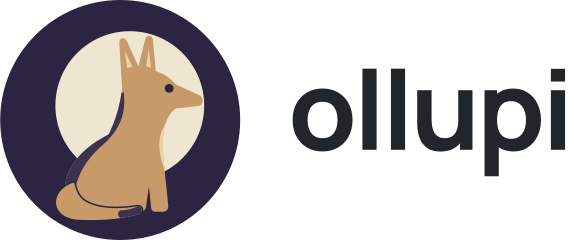
</h1>

Ollupi is a Go agent framework for cloud providers building massively concurrent personal agent services.

Instead of isolating each agent in its own VM or container, Ollupi pools the runtime and persists each agent's run state:

- **Recoverable at any moment.** Every step is written to the database before it runs, and no scheduling state lives in memory. After a release, restart or crash, sessions continue from where they stopped.
- **Inactive sessions cost nothing.** A session waiting on a user, an approval or a subagent leaves the execution pool and remains only as database records, using no memory or compute.
- **Controlled concurrency.** The execution pool schedules by slot, and model calls are limited per connection to match the provider's account quota; bursts queue.

Sessions, subagents and scheduled tasks all share one execution pool. [ollupi-desktop](https://github.com/0xfakeSpike/ollupi-desktop) is the desktop client built on Ollupi.

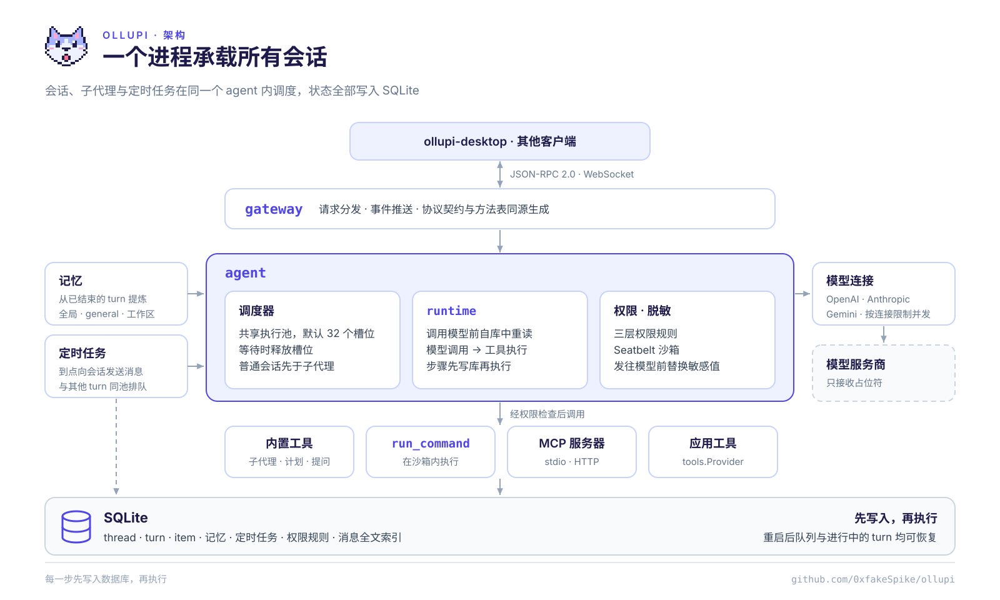

## How it differs from per-agent isolation

| | One VM or container per agent | Ollupi |
|---|---|---|
| One process hosts | One session | All sessions |
| Inactive sessions | Process stays up, or is rebuilt with a cold start | Database records only |
| Waiting on a user or approval | Process sits suspended, still holding memory | Leaves the execution pool, using no resources |
| Scheduling state | Process memory | SQLite |
| After a restart | In-progress work is interrupted | Continues from where it stopped |
| Subagents | Special mechanism or child process | Ordinary sessions, queued in the same pool |
| Scheduled tasks | External cron starts a process | A message to the session when due, queued in the same pool |

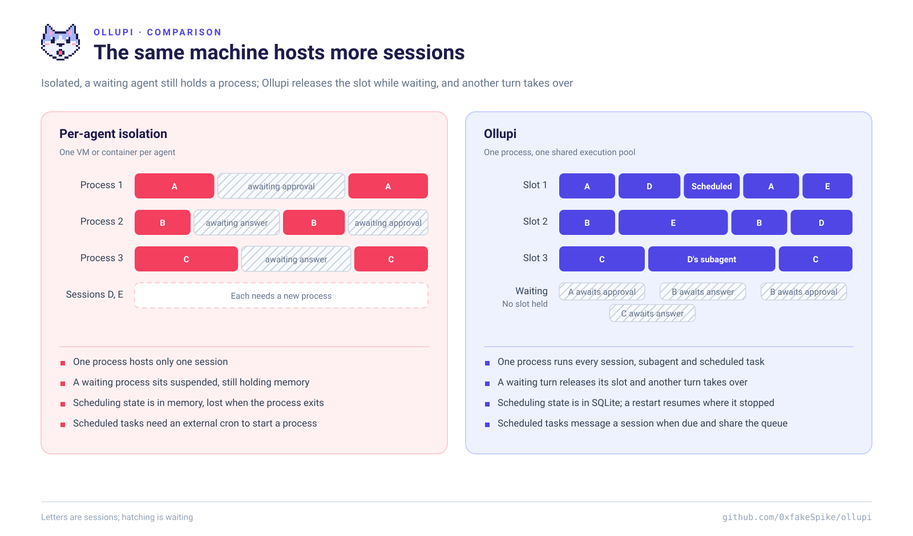

## Benchmarks

These results use a simulated model and tools. They measure scheduling and persistence, not model quality. See [bench](bench/README.md) for the method, full data and commands to reproduce them.

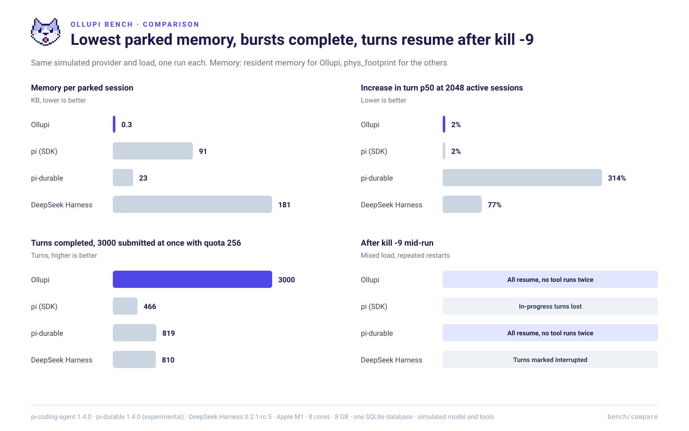

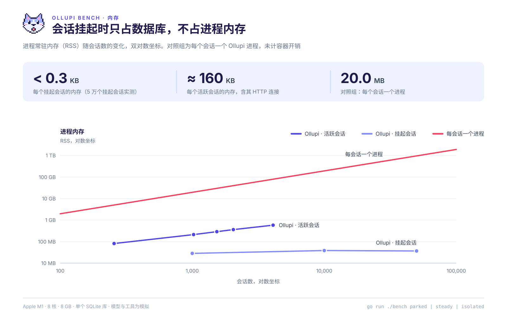

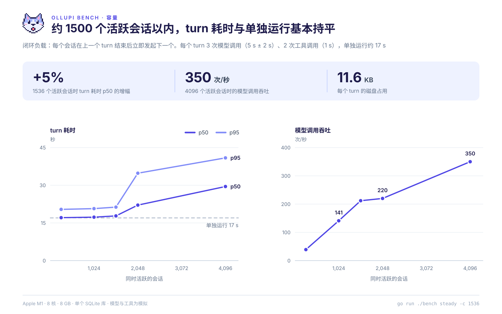

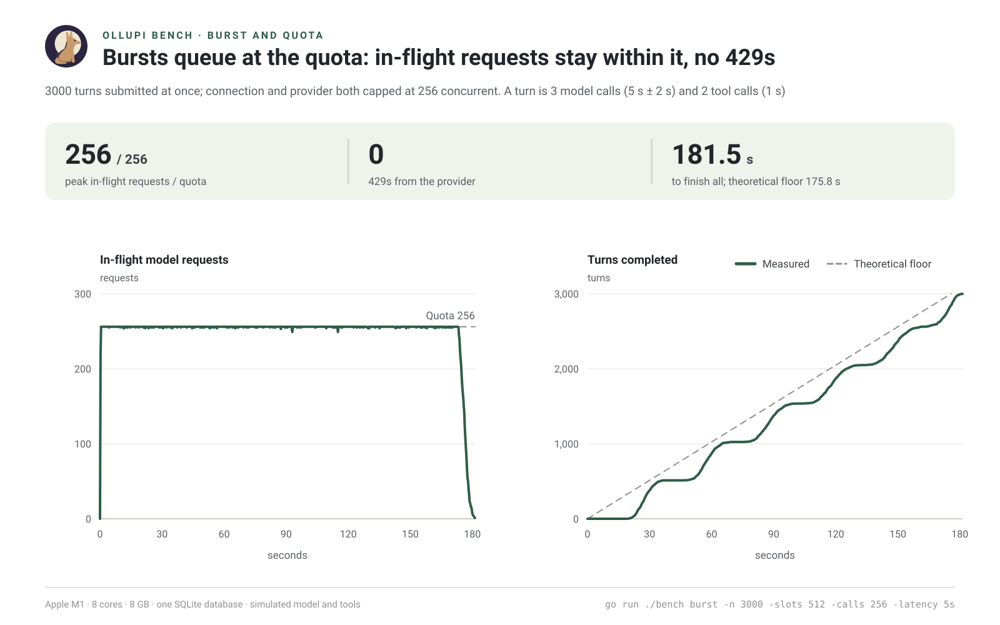

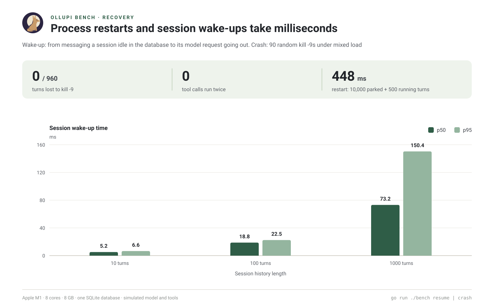

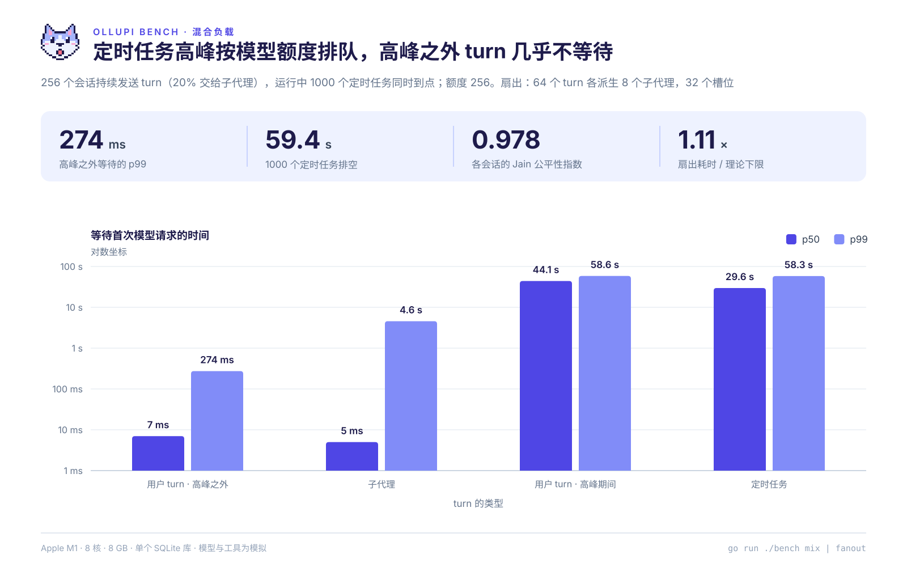

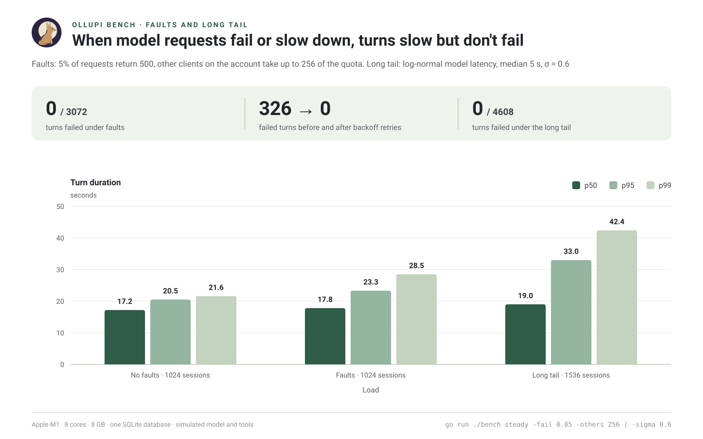

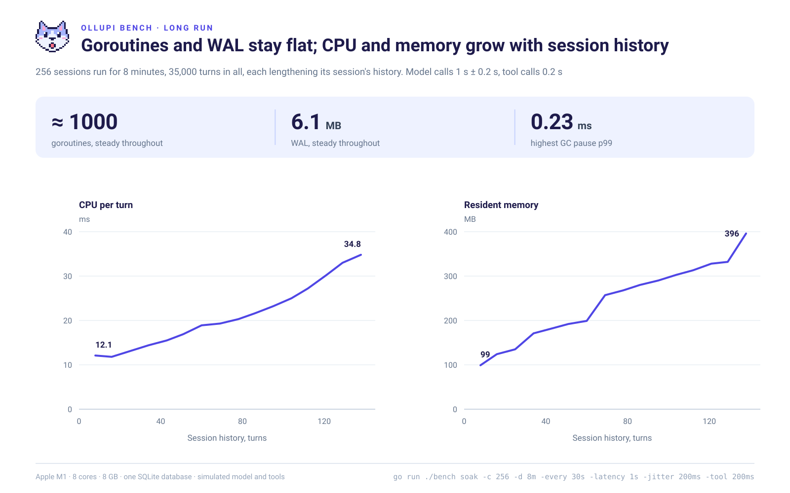

## Execution model

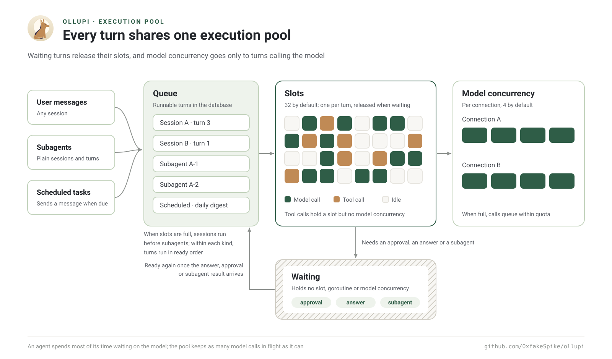

Every runnable turn in every session, whether it comes from a user, a subagent or a scheduled task, enters one queue and runs on a fixed number of slots (32 by default). A turn waiting on a user, an approval or a subagent releases its slot, holds no goroutine or model concurrency, and becomes ready again when the wait ends. When slots run short, ordinary sessions go before subagents, and turns of the same kind run in the order they became ready. Model concurrency is limited per connection (4 per connection by default), and tool execution uses none of it. Model requests that hit a 429, a 5xx or a dropped connection retry with backoff, up to 8 times, keeping their slot and model concurrency while they wait.

Every step is written to the database before it runs and no scheduling state lives in memory, so after a process restart the same scheduling logic recovers in-progress turns. Tool calls distinguish `pending` (not yet run) from `inProgress` (may have taken effect): on recovery the former run as usual, while the latter are marked failed with a prompt to verify, and are never run twice.

## Multi-user and shards

One database is one shard. Users in a shard share tables and are isolated per user. A lease ensures that only one process runs a shard at a time; when that process exits, a standby takes over and continues from where it stopped. The number of shards sets capacity. Clients connect only to the router, which forwards each user's connection to their shard.

Everything a user runs stays in their own sandbox: commands, files and MCP servers are reached through `sandbox.Box`, and integrating a cloud sandbox only takes implementing `sandbox.Machine`. A user's environments are the boxes a conversation can be started in — this machine, and cloud sandboxes they add — and a conversation keeps the one it was started in (`environment/list`, `thread/start` with `environmentId`). HTTP MCP requests from cloud sandbox users leave from the shard process and can only reach public addresses. Model calls can go through the user's own client, and attachments are stored through `blobs.Store`.

Two choices of the sandbox trade safety for ordinary work. A repository's `.git` is writable inside it, hooks included, so `git init` and `git clone` work there; a hook a command writes runs later for whoever runs git outside the sandbox. Under the `never` approval policy, a command that asks to leave the sandbox runs on the host without asking; a server that runs users' commands with `sandbox.Here` should not offer that policy.

Building and testing need SQLite's FTS5: `go test -tags sqlite_fts5 ./...`, or set `GOFLAGS=-tags=sqlite_fts5`.

Clients authenticate with `Authorization: Bearer <token>`. Browsers can't set this header, so they put the token in the WebSocket subprotocol instead: `new WebSocket(url, ["ollupi.token", token])`. Tokens never go in the URL.

## License

[MIT](LICENSE)
