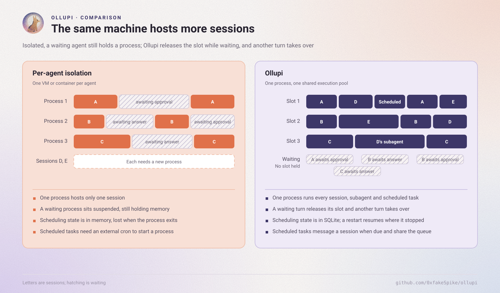
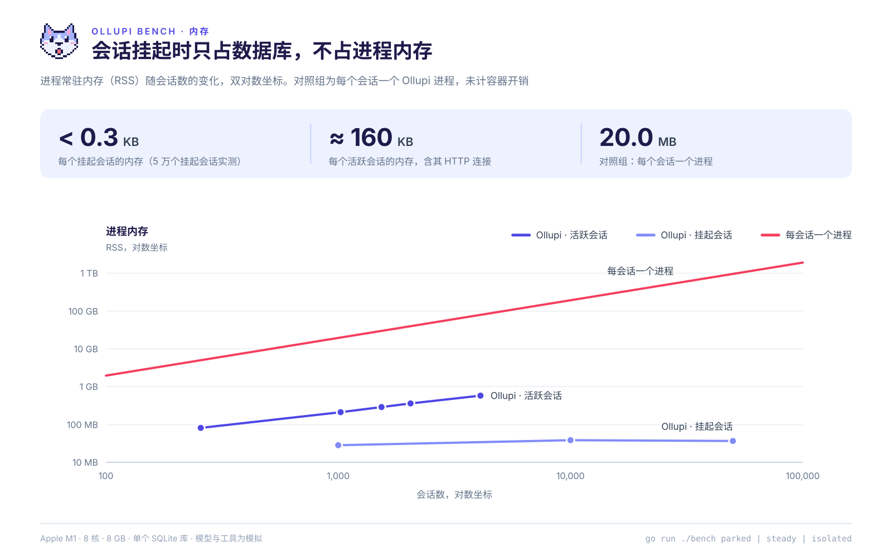
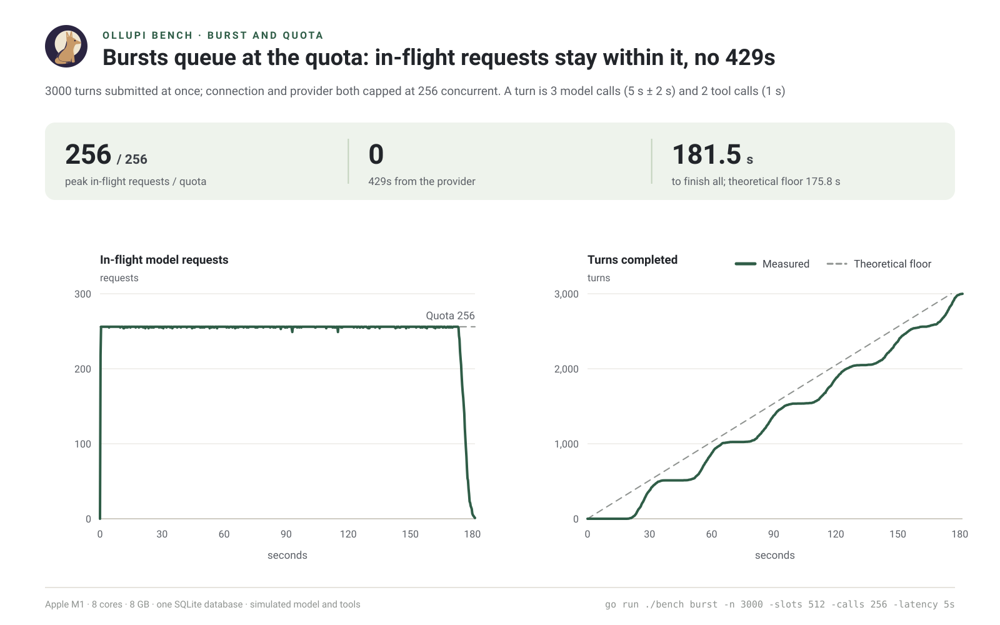
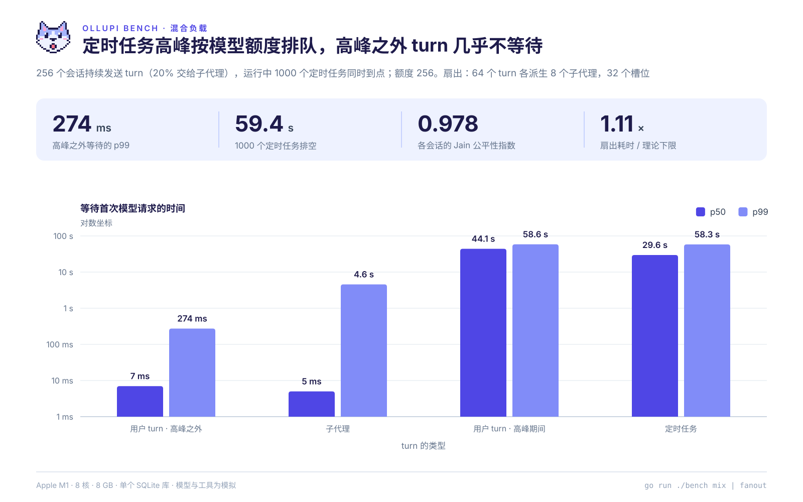
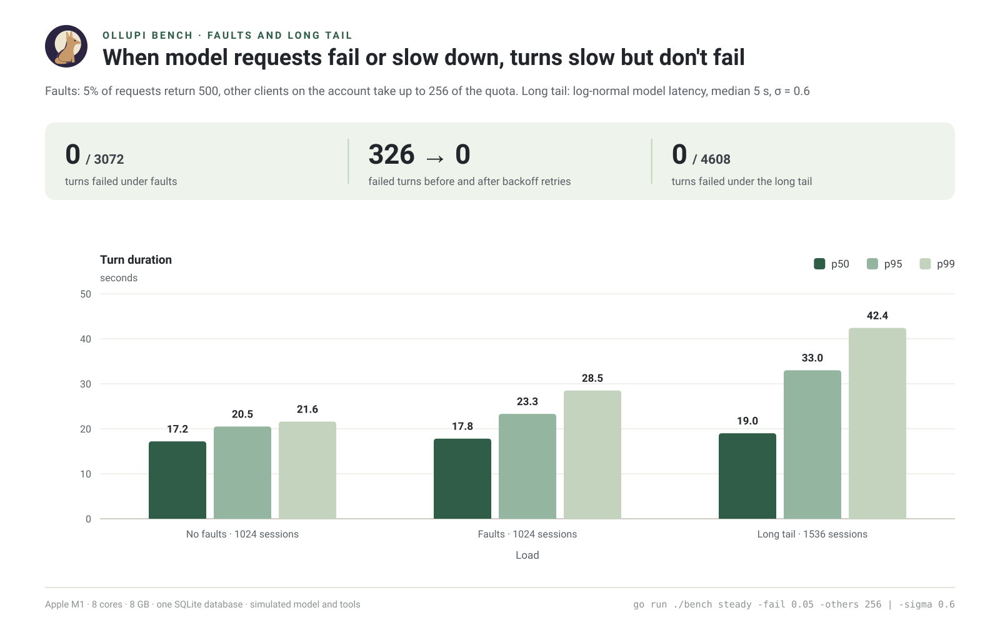
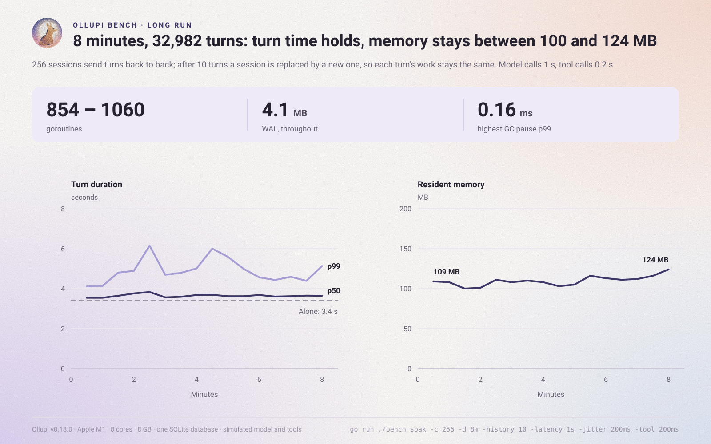
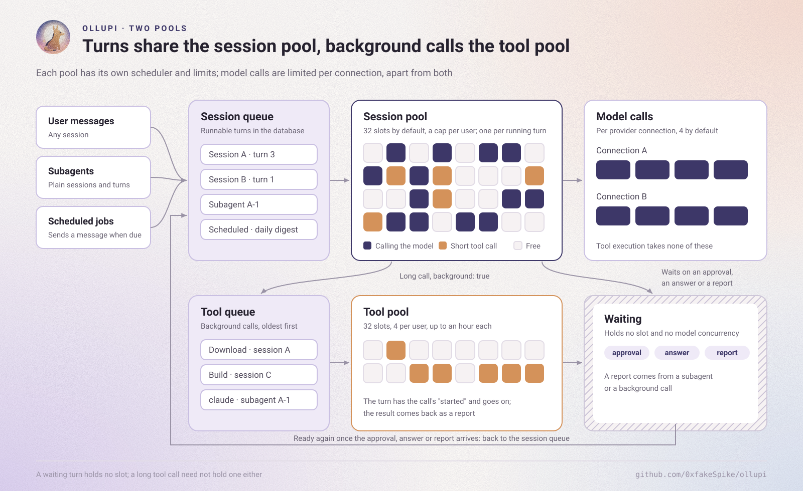

<h1>
  <picture>
    <source media="(prefers-color-scheme: dark)" srcset="https://raw.githubusercontent.com/0xfakeSpike/ollupi-desktop/main/assets/brand/logo-dark.svg">
    
  </picture>
</h1>

Ollupi is a Go agent framework for cloud providers building massively concurrent personal agent services.

Instead of isolating each agent in its own VM or container, Ollupi pools the runtime and persists each agent's run state:

- **Recoverable at any moment.** Every step is written to the database before it runs, and no scheduling state lives in memory. After a release, restart or crash, sessions continue from where they stopped.
- **Inactive sessions cost nothing.** A session waiting on a user, an approval or a subagent leaves the execution pool and remains only as database records, using no memory or compute.
- **Controlled concurrency.** The execution pool schedules by slot, and model calls are limited per connection to match the provider's account quota; bursts queue.

Sessions, subagents and scheduled jobs all share one execution pool. [ollupi-desktop](https://github.com/0xfakeSpike/ollupi-desktop) is the desktop client built on Ollupi.

## How it differs from per-agent isolation

| | One VM or container per agent | Ollupi |
|---|---|---|
| One process hosts | One session | All sessions |
| Inactive sessions | Process stays up, or is rebuilt with a cold start | Database records only |
| Waiting on a user or approval | Process sits suspended, still holding memory | Leaves the execution pool, using no resources |
| Scheduling state | Process memory | SQLite |
| After a restart | In-progress work is interrupted | Continues from where it stopped |
| Subagents | Special mechanism or child process | Ordinary sessions, queued in the same pool |
| Scheduled jobs | External cron starts a process | A message to the session when due, queued in the same pool |

## Benchmarks

These results use a simulated model and tools. They measure scheduling and persistence, not model quality. They were measured on v0.8.3 to v0.8.5, before multi-user, shards and the conversation log, and have not been measured again since. See [bench](bench/README.md) for the method, full data and commands to reproduce them.

## Execution model

Every runnable turn in every session, whether it comes from a user, a subagent or a scheduled job, enters one queue and runs on a fixed number of slots (32 by default). A turn waiting on a user, an approval or a subagent releases its slot, holds no goroutine or model concurrency, and becomes ready again when the wait ends. When slots run short, ordinary sessions go before subagents, and turns of the same kind run in the order they became ready. Model concurrency is limited per connection (4 per connection by default), and tool execution uses none of it. Model requests that hit a 429, a 5xx or a dropped connection retry with backoff, up to 8 times, keeping their slot and model concurrency while they wait.

Each conversation is an append-only log: a turn's state, what it waits on and what runs next are read from the log, every step is appended before it runs, and no scheduling state lives in memory, so after a process restart the same logic picks up in-progress turns. A tool call appended but not started runs as usual; one started without a result may have taken effect, so it is ended as cut off with a prompt to verify, and is never run twice. Everything a commit changes reaches clients, the scheduler and memory extraction through one change feed, numbered by commit.

## Multi-user and shards

One database is one shard. Users in a shard share tables and are isolated per user. The engine knows nothing of shards: package `shard` runs a process as one. A `shard.Member` holds the shard's lease in the deployment's catalog, which publishes the holder's address with it, so only one process runs a shard at a time; when that process exits, a standby that waits on the lease takes over and continues from where it stopped. Each taking of a shard has an epoch above every one before it, which the shard's database keeps and checks on every write, so a process that stalled past its lease cannot write over the one that took the shard. The member reports the shard's load as it renews the lease, by a measure the deployment chooses (users active of late, turns under way, connections), and runs the engine only while it holds the shard. The number of shards sets capacity. Clients reach one address and never learn which shard they are on: where a load balancer can call out over Envoy's external processing protocol, as Google Cloud's Application Load Balancer does with a route extension, `router/extproc` tells it each handshake's shard in the `x-ollupi-shard` header and the load balancer holds the connections; `router.Router` takes the connections it cannot place, and anywhere without such a load balancer it takes them all. Both find the shard and its holder's address with one catalog lookup, which places a new user on the lighter of two accepting shards drawn at random, by the load each reports. The catalog is kept apart from the shards' data, behind the interface `catalog.Catalog` (`catalog`). It decides each lease by its own clock, and a holder counts its lease from before it asked and gives up a margin early, so that it stops before any other process can start. `catalog.SQL` keeps the catalog in a SQLite database of its own; a deployment that needs it to outlive any one machine implements `catalog.Catalog` over a coordination service, such as etcd, or a database served apart from the shards. A shard only checks that a connection is its user's, through `gateway.Options.Admit` set to `shard.Member.Admit`, and tells one that is not to come back later (503 with `Retry-After`). A process serves, and answers `/healthz`, only while it holds its shard, so a load balancer's health check sends the shard's connections to the process that holds it.

Everything a user runs stays in their own sandbox: commands, files and MCP servers are reached through `sandbox.Box`, and integrating a cloud sandbox only takes implementing `sandbox.Machine`. A user's environments are the boxes a conversation can be started in — this machine, and cloud sandboxes they add — and a conversation keeps the one it was started in (`environment/list`, `thread/start` with `environmentId`). HTTP MCP requests from cloud sandbox users leave from the shard process and can only reach public addresses. Model calls can go through the user's own client, and attachments are stored as files under the home's `attachments` folder (`blob.Dir`).

Two choices of the sandbox trade safety for ordinary work. A repository's `.git` is writable inside it, hooks included, so `git init` and `git clone` work there; a hook a command writes runs later for whoever runs git outside the sandbox. Under the `never` approval policy, a command that asks to leave the sandbox runs on the host without asking; a server that runs users' commands in a sandbox on its own machine should not offer that policy. `sandbox.Here` is no sandbox at all: every command it runs reaches the host under any policy, so it suits only users who may use the machine fully.

Building and testing need SQLite's FTS5: `go test -tags sqlite_fts5 ./...`, or set `GOFLAGS=-tags=sqlite_fts5`.

Clients authenticate with `Authorization: Bearer <token>`. Browsers can't set this header, so they put the token in the WebSocket subprotocol instead: `new WebSocket(url, ["ollupi.token", token])`. Tokens never go in the URL.

A user may hold up to four connections at once, one per device, and each hears all of the user's events; a fifth takes the oldest's place, which closes with 4000 and should not reconnect on its own. The gateway pings each connection every 30 seconds and drops one whose peer has not answered within 15, and closes each with 1001 at a random time between 15 and 20 hours after it opened, under the 24 hours Google Cloud's load balancer keeps a WebSocket open, so that connections opened together are not cut together. Connections are admitted at a bounded rate, so after a restart a client may be refused with 503 and a `Retry-After` in seconds. `gateway.Options.Connections` changes these bounds. What a client does after each close code and each refused handshake is part of the protocol, under `closes` and `handshakes` in `protocol.schema.json`: reconnect after a random wait of up to 10 seconds, with backoff, after `Retry-After`, or not on its own; once back, it reads its threads again, since it heard nothing meanwhile.

## License

[MIT](LICENSE)
