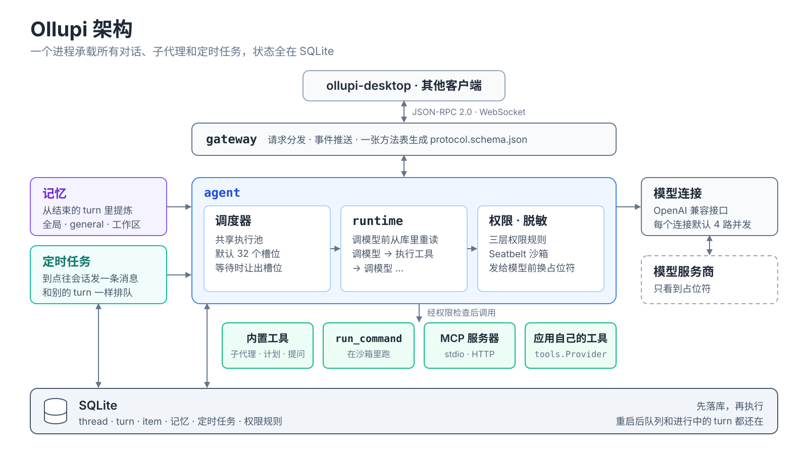
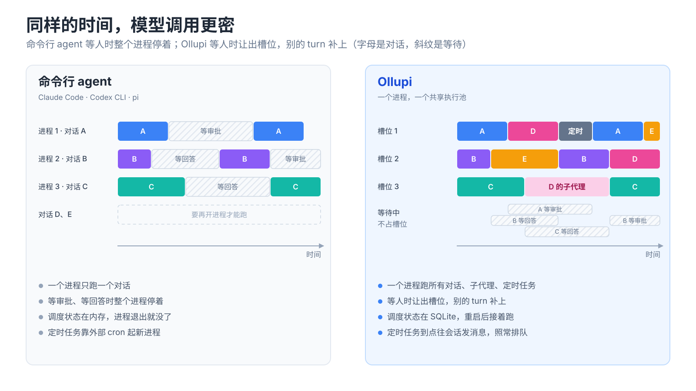
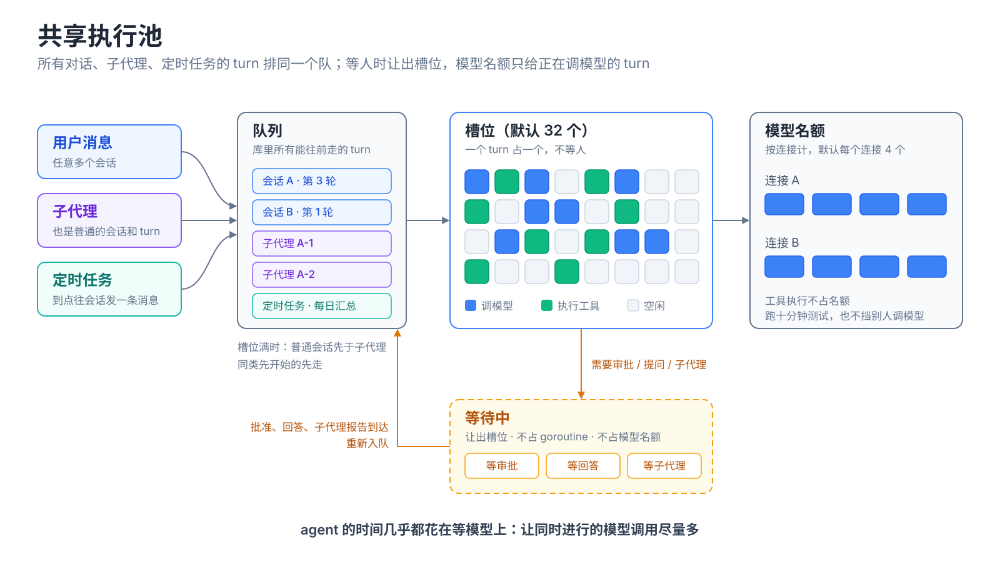
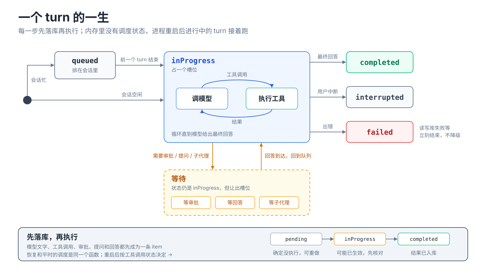
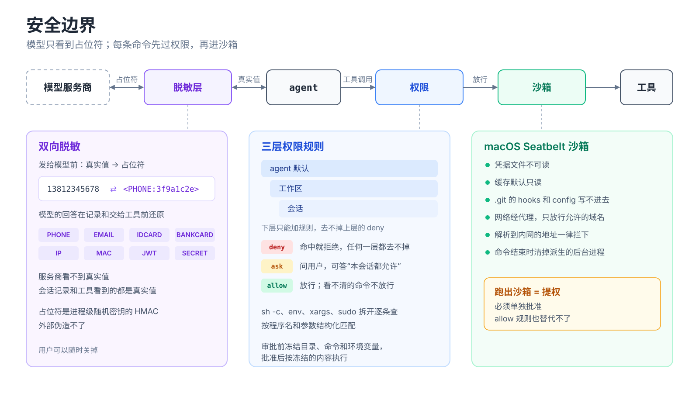
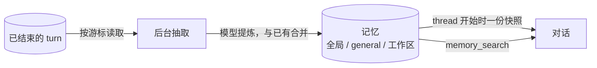

<h1>
  
</h1>

一个 Go 库，用来构建常驻运行的 agent 服务。

所有对话、子代理、定时任务共享一个执行池：每一轮都是池里的任务，等人、等子代理时让出位置，并发名额只给正在调模型的任务。agent 的时间几乎都花在等模型上，所以这样能让同时进行的模型调用尽量多。状态全在 SQLite 里，重启后队列和进行中的任务都还在。

[ollupi-desktop](https://github.com/0xfakeSpike/ollupi-desktop) 是它的桌面端界面。



## 和命令行 agent 的区别

| | Claude Code、Codex CLI、pi | Ollupi |
|---|---|---|
| 一个进程 | 一个对话 | 所有对话 |
| 并行的范围 | 一个对话里的子代理 | 所有对话、子代理和定时任务 |
| 等审批、等回答时 | 整个进程停着 | 这一轮退出队列，不占任何资源 |
| 调度状态在哪 | 内存 | SQLite，重启后队列还在 |
| 子代理 | 特殊机制或子进程 | 普通的会话和 turn，和别的一起排队 |
| 定时任务 | 外部 cron 起新进程 | 到点往会话里发一条消息，照常排队 |



## 它是怎么跑的



队列里是所有会话中能往前走的 turn，无论来自用户、子代理还是定时任务。一组槽位（默认 32 个）消费它；要等人或等子代理的 turn 让出槽位，不占 goroutine，也不占模型名额，等的事一到就回到队列。槽位满时普通会话先于子代理，同类先开始的先走：先派出的子代理先完成，父任务也就先完成。并发上限按模型连接计（默认每个连接 4 个），工具执行不占名额，跑十分钟测试的工具不会挡住别的会话调模型。

### 一个 turn 的一生



每一步都先落库再执行：模型的文字、每次工具调用、审批、提问和回答都先成为一条 item。runtime 每次调模型前从库里重读，内存里没有调度状态，所以进程重启后进行中的 turn 接着跑，恢复和平时的调度是同一个函数。工具调用区分 `pending`（确定没执行）和 `inProgress`（可能已生效），重启后知道哪些能重做、哪些要先核对。

出错就暴露：读写库失败、会话推不动、权限依赖的数据读不出来，都立刻结束当前 turn 并通知界面，不退回更宽松的规则，也没有定时对账来掩盖问题。

## 安全边界



**权限分三层叠加。** deny / ask / allow 规则按 agent 默认、工作区、会话三层合并，下层只能加规则，去不掉上层的 deny。命令按程序名和参数结构化匹配，`sh -c`、`env`、`xargs`、`sudo` 这类包装会拆开逐条检查，看不清的一律问用户。审批前先冻结目录、命令和环境变量，批准后按冻结的内容执行。

| 规则 | 作用 |
|---|---|
| `deny run_command(rm -rf *)` | 命中就拒绝，任何一层都去不掉 |
| `ask run_command(git push *)` | 命中就问，用户可以回答"本会话都允许" |
| `allow run_command(go test *)` | 命中就放行；看不清的命令（变量、`$(...)`）不放行 |

**macOS Seatbelt 沙箱。** 命令默认在沙箱里跑：凭据文件不可读，缓存默认只读，`.git` 的 hooks 和 config 写不进去。网络经代理只放行允许的域名，并拦下解析到内网的地址。命令结束时清掉它派生的所有后台进程。跑出沙箱算提权，必须单独批准，allow 规则也替代不了。

**双向脱敏。** 手机号、身份证、银行卡、邮箱、密钥在发给模型前换成占位符，模型的回答在记录和交给工具前还原。服务商看不到真实值，会话记录和工具看到的都是真实值。占位符用每个安装各自的密钥做 HMAC（存在库里，重启不变，历史记录的占位符因此保持一致），外部伪造不了。用户可以随时关掉。

## 记忆



后台协程从已结束的 turn 里提炼记忆，和已有的合并（新建、更新、废弃）；用户改过或遗忘的条目不会被自动覆盖。记忆按内容分三个范围：全局（关于用户本人）、general（不属于任何工作区的对话）、工作区。thread 开始时载入一份快照放在对话开头，之后请求前缀不变，有利于服务商的前缀缓存；新记忆等下一次压缩时才换进来。

## 内置工具

| 工具 | 作用 |
|---|---|
| `Agent` | 派生子代理，结果由另一个 turn 回答 |
| `update_plan` | 计划与进度，界面直接显示 |
| `request_user_input` | 结构化提问，回答成为调用结果 |
| `read_tool_output` | 分段读回被截短的工具输出 |
| `memory_search` | 搜索记忆 |
| `list_skills` `activate_skill` `read_skill_resource` | Agent Skills |
| `create_scheduled_job` `pause_scheduled_job` `delete_scheduled_job` `list_scheduled_jobs` | 定时任务 |
| `run_command` | 沙箱里跑命令（`tools/workspace`，应用装配） |
| `edit_file` `write_file` | 改写和新建文件，只写沙箱允许的目录，审批时冻结 diff（`tools/workspace`，应用装配） |
| `web_fetch` | 读取公网网页，HTML 转成类 Markdown 正文（`tools/web`，应用装配） |
| `<服务器>__<工具>` | MCP 服务器的工具，stdio 或 streamable HTTP（`tools/mcp`，应用装配） |

应用自己的工具实现 `tools.Provider` 接入。所有工具都受 `Config.Tools` 允许列表和权限规则约束。

## 模型

`pkg/llm` 有三种连接，都实现 `llm.Client`：`NewOpenAI`（兼容 OpenAI 的 API）、`NewAnthropic`、`NewGemini`。每次回复另存一份服务商原样的记录，下次发给同一服务商时原样回放，Anthropic 的思考块签名和 Gemini 的 thought signature 因此能带回去；Anthropic 的思考块在它之前的内容变了以后不再回放。

## 协议

网关是 WebSocket 上的 JSON-RPC 2.0，方法名对齐 Codex app-server。`gateway/protocol.go` 里的一张表既分发请求，也生成 `protocol.schema.json`，内置工具的参数类型同时生成模型看到的 schema 和契约里的 schema，两边来自同一份定义。测试用假模型跑一段完整会话，按契约校验收发的每一条消息。界面的类型从 `protocol.schema.json` 生成。

## 快速开始

```go
db, err := repo.Open(home)
if err != nil {
	log.Fatal(err)
}
a := agent.New(agent.Config{
	Name:        "ollupi",
	Models:      []llm.Model{{Name: "gpt-5", Connection: "openai"}},
	Connections: map[string]llm.Client{"openai": llm.NewOpenAI("", os.Getenv("OPENAI_API_KEY"), 0, nil)},
	Settings:    permission.Settings{ApprovalPolicy: string(permission.OnRequest)},
	DB:          db,
	OnEvent: func(e agent.Event) {
		if e.Kind == agent.EventItemDelta {
			fmt.Print(e.Delta)
		}
	},
})
if err := a.Start(ctx); err != nil {
	log.Fatal(err)
}
thread, _ := a.StartThread("", "问候", permission.Settings{})
a.StartTurn(thread.ID, agent.Input{Text: "你好"})
```

工具通过 `Config.Providers` 接入。记忆、定时任务和网关与 agent 并列，由应用启动：`go mem.Run(ctx)`、`go jobs.Run(ctx, send)`、`server.Serve(ctx, listener)`。关闭时取消 ctx 再 `a.Wait()`。完整装配见 ollupi-desktop 的 `sidecar/internal/host/host.go`。修改协议后 `go generate ./gateway`。

## 许可

[MIT](LICENSE)
