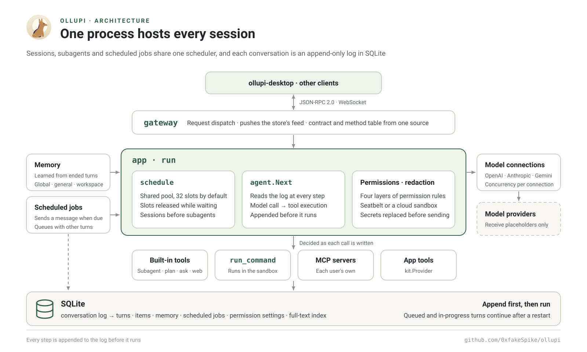
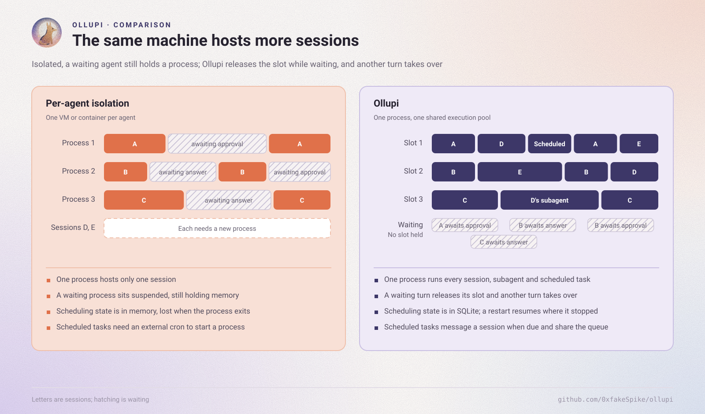
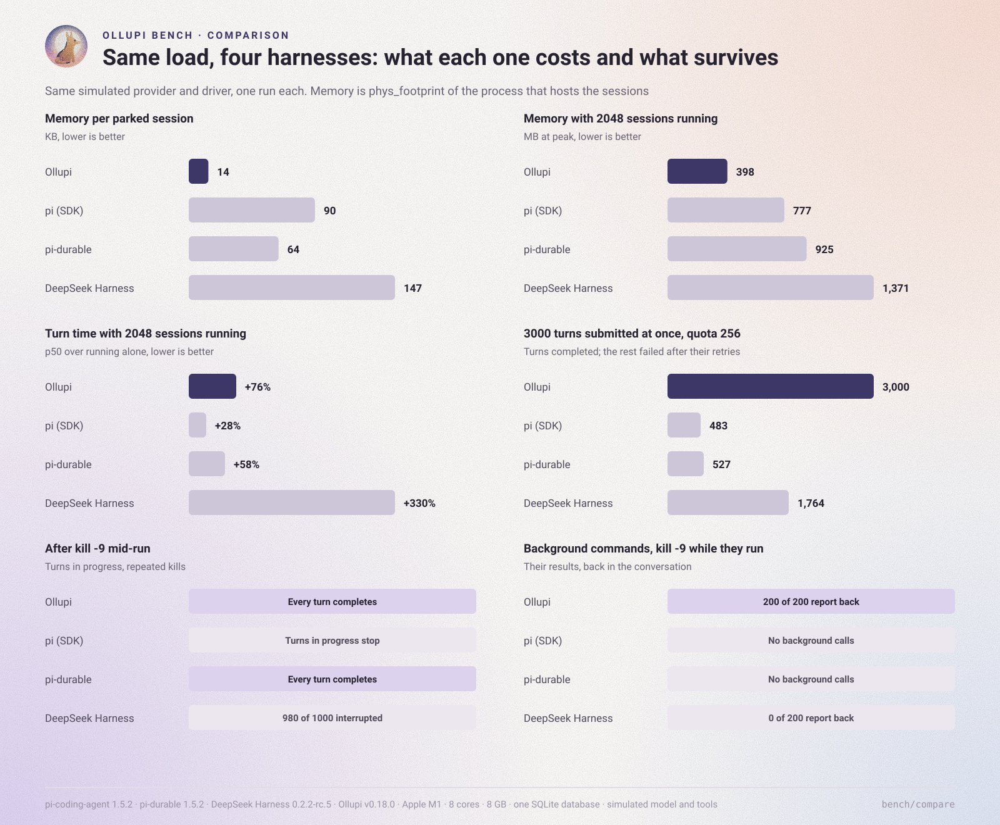

<h1>
  <picture>
    <source media="(prefers-color-scheme: dark)" srcset="https://raw.githubusercontent.com/0xfakeSpike/ollupi-desktop/main/assets/brand/logo-dark.svg">
    
  </picture>
</h1>

[English](README.md) | [简体中文](README.zh-CN.md)

Ollupi 是一个用 Go 编写、面向持久化与多租户场景的 Agent runtime，支持 Agent 会话的宕机恢复：会话状态持久化到 SQLite，进程重启后会重建并继续执行可运行的轮次。在分片部署中，备份进程还可以通过分片租约接管原分片。工具调用支持异步执行，并由独立的工具池控制全局与单用户并发，因此长时间任务不会占用会话执行槽位。

## 可以用它做什么

- **本地编程 Agent。** 为它配置工作区、文件与命令工具、审批、记忆和不同类型的子 Agent。
- **多租户 Agent 后端。** 在一个分片中服务多个用户，并为每个用户保留独立的模型、沙箱、连接、额度和历史记录。
- **长时间、可恢复的任务。** 统一排队对话、后台命令、子 Agent 和定时任务，不再让每个任务绑定一个进程或 VM。

同一套引擎既适合单机桌面产品，也适合多分片服务。[ollupi-desktop](https://github.com/0xfakeSpike/ollupi-desktop) 就是基于 Ollupi 构建的桌面客户端。



## 核心能力

| 能力 | Ollupi 提供什么 |
|---|---|
| 宕机恢复 | 使用只追加的对话日志；进程重启后，调度器会重建并继续执行可运行的轮次 |
| 工具异步执行 | 支持后台执行的工具会脱离当前轮次，在独立工具池中运行；工具池分别限制全局和单用户并发，完成后把报告送回原轮次 |
| 调度 | 会话执行采用池化调度，支持单用户上限、时限和公平排序；分片部署还可由备份进程接管 |
| 模型 | 支持 OpenAI 兼容、Anthropic 和 Gemini；每个连接独立控制并发与重试，可给用户配置各自的模型 |
| 工具与上下文 | 文件、读取、命令工具，MCP Server，Skills，记忆召回与抽取，上下文压缩和附件 |
| Agent 工作流 | 专用子 Agent、用于协调项目的中枢、待办、定时任务、计划和用户提问 |
| 隔离与权限 | 按用户隔离的命令与文件沙箱、分层权限规则、审批和提权 |
| 服务接入 | 带认证的 WebSocket 协议、多设备连接、重连指引、用量和在线时长查询 |
| 水平扩展 | SQLite 分片、租约、故障转移 epoch、目录服务、按负载放置用户和 Envoy 外部处理器 |

## 为什么采用池化 Agent

| | 每个 Agent 一个 VM 或容器 | Ollupi |
|---|---|---|
| 一个进程承载 | 一个会话 | 所有会话 |
| 空闲会话 | 进程常驻，或恢复时冷启动 | 只保留数据库记录 |
| 等待用户或审批 | 进程挂起并继续占用内存 | 释放槽位，只保留数据库记录 |
| 会话状态 | 进程内存 | SQLite |
| 重启之后 | 进行中的工作被中断 | 从停止的位置继续 |
| 长时间工具调用 | 调用返回前一直占着进程或槽位 | 进入后台工具池，会话槽位恢复可用 |
| 配置备份进程时发生故障 | 是否恢复取决于外部编排 | 备份进程取得分片租约并接管 |
| 调用在崩溃时被切断 | 重做或丢失 | 标记为可能已经执行，绝不自动重跑 |
| 子 Agent | 特殊机制或子进程 | 普通会话，进入会话池排队 |
| 定时任务 | 外部 cron 启动进程 | 到期后向会话写入消息，进入会话池排队 |



## 效果与评测

Bench 使用真实的 Host、SQLite 存储、调度器和 gateway，只模拟模型与工具。它衡量调度和持久化能力，不衡量模型质量。下列数字来自 v0.18.0；完整方法、限制、原始输出与复现命令见 [bench](bench/README.md)。

| 负载 | 结果 |
|---|---|
| 一次提交 3,000 个轮次，Provider 配额为 256 | 3,000 个全部完成，没有 429 |
| 50,000 个会话停在等待用户的状态 | 常驻内存共 34 MB，每个会话约 7 KB 磁盘 |
| 活跃轮次和工具执行期间反复 `kill -9` | 所有已接受的轮次都完成，没有工具调用执行两次 |
| 异步后台命令运行期间 `kill -9` | 200 个调用全部有结果返回，其中被切断的会明确标记 |

限制：实测超过 1,536 个会话后，轮次延迟会因所有会话等待一个 SQLite 连接而上升；4,096 个会话时约为单会话延迟的 2.8 倍。扩容路径是增加分片。



## 执行模型

引擎有两个调度器。会话池用固定数量的槽位执行来自用户、子 Agent 和定时任务的轮次；支持异步执行的工具（例如带 `background: true` 的 `run_command` 和 `claude`）进入独立工具池，并分别受全局与单用户并发限制。调用完成后，工具会向发起它的轮次送回报告。模型并发按 Provider 连接限制，与工具执行分开计算。等待用户、审批、子 Agent 或后台报告的轮次会释放槽位。

每个会话都是一份只追加的日志。工具开始执行前，执行意图先写入 SQLite；模型响应和工具结果在完成后追加。进程重启后，从数据库重新构造可调度的工作。已经开始、但没有留下结果的工具会以“被切断”告知模型和用户，不会自动再执行一次。客户端的更新、调度器的唤醒和记忆抽取都从同一个变更流获得通知。

更多细节见[工作区、会话、轮次和条目生命周期](docs/lifecycle.md)。

## 多用户部署与分片

一个 SQLite 数据库就是一个分片。分片中的用户共享表，但数据按用户隔离。分片进程从独立目录服务取得可续租的租约；当前进程退出后，备份进程取得该分片的租约，并从数据库恢复会话工作。这是与 Agent 级宕机恢复互补的跨进程故障转移路径。租约 epoch 防止已经失效的旧进程在新进程启动后继续写入。Router 把用户放到可接受流量的分片，并在使用 Envoy 时把选中的分片告诉外部处理器。

命令、文件和本地 MCP Server 都通过 `sandbox.Box` 访问；云沙箱只需实现 `sandbox.Machine`。对话会保留启动时选择的环境。模型流量可以使用每个用户自己的连接，附件保存在 Host 的 `attachments` 目录中。

## 跑成一个服务器

桌面端只是引擎的一个客户端，不是唯一的：

```bash
go install github.com/0xfakeSpike/ollupi/cmd/ollupi@latest
export OLLUPI_GATEWAY_TOKEN=$(openssl rand -hex 32)
export OLLUPI_OPERATOR_TOKEN=$(openssl rand -hex 32)
ollupi serve --home ~/.ollupi --listen 127.0.0.1:7777
```

一个连接的 token 是「网关密钥.身份」（`<secret>.<profile>`）；用运营者密钥连接时还能改模型目录、新建身份。桌面端把这个地址和 token 注册成自己的一个服务器。允许的 Host 和 Origin、TLS、数据布局见 [把 ollupi 跑成一个服务器](docs/serve.md)。

## 安全与运行边界

- `sandbox.Here` 让命令拥有这台机器的完整权限，只适合允许使用整台机器的用户。
- 在 `never` 审批策略下，提权命令不会询问用户。不要向不受信任的用户提供该策略。
- 仓库的 `.git` 在沙箱内可写。命令写入的 Git hook 之后可能在沙箱限制之外执行。
- 对非常大的单分片历史和高并发，SQLite 是实测瓶颈。分片数量应根据实际负载决定，并记住每个分片只有一个 SQLite 连接。
- Bench 数字来自 v0.18.0，且在同一台 Apple M1 上测得。部署容量应使用 [bench](bench/README.md) 在自己的环境中重新验证。

## 文档

- [Bench 方法、结果与复现](bench/README.md)
- [Terminal-Bench 评测流程](eval/README.md)
- [工作区、会话、轮次和条目生命周期](docs/lifecycle.md)
- [把 ollupi 跑成一个服务器](docs/serve.md)
- [WebSocket 协议 schema](gateway/protocol.schema.json)
- [完整的用户与部署文档](https://github.com/0xfakeSpike/ollupi-docs)

使用 SQLite FTS5 构建和测试：

```bash
go test -tags sqlite_fts5 ./...
```

## License

[MIT](LICENSE)
