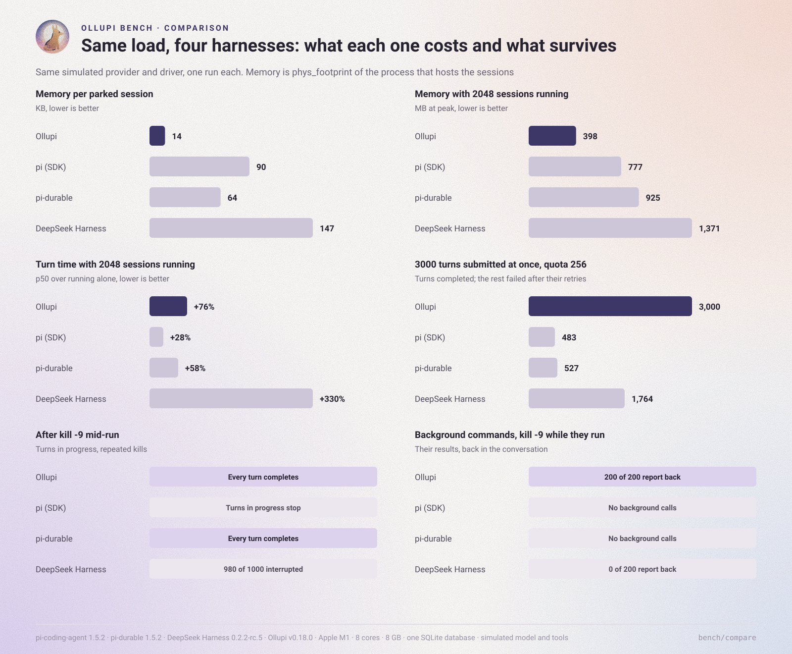
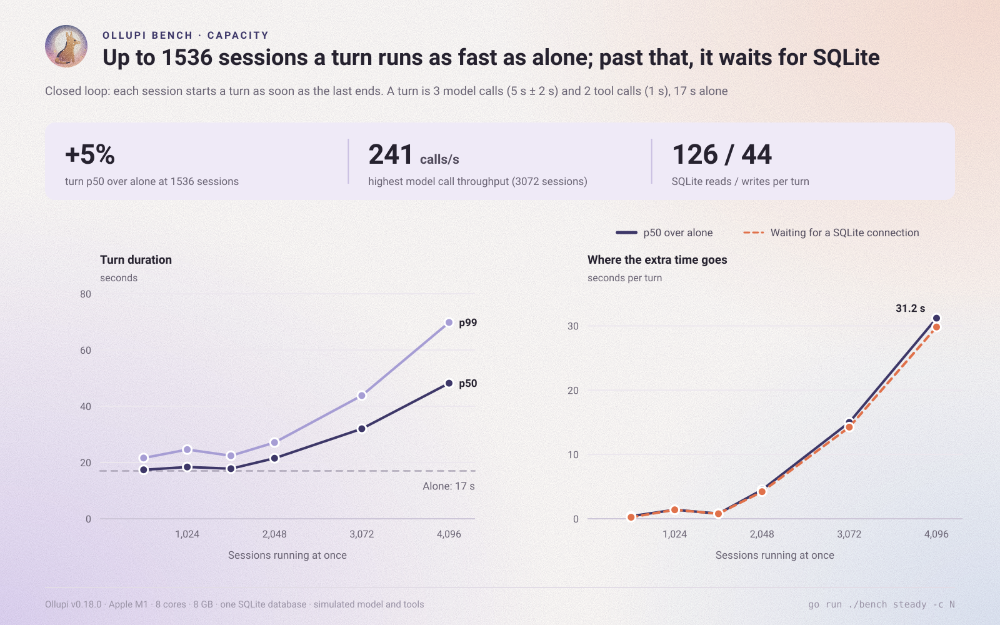
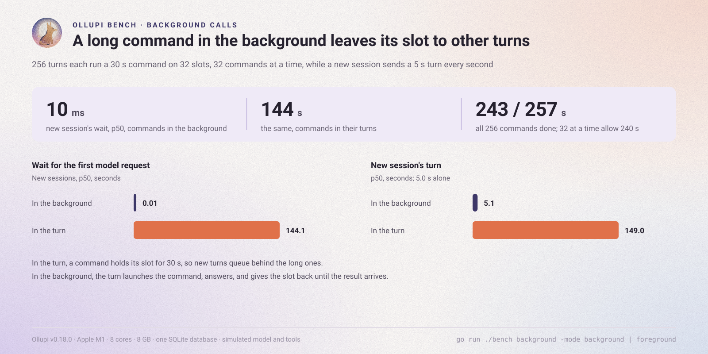
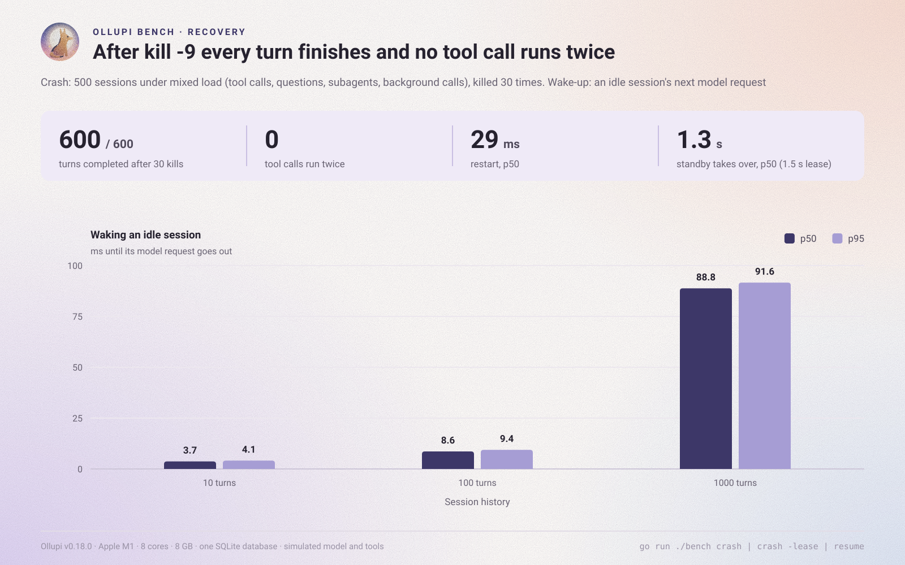
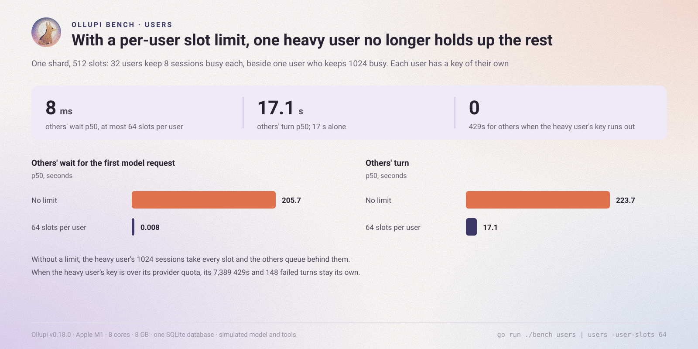
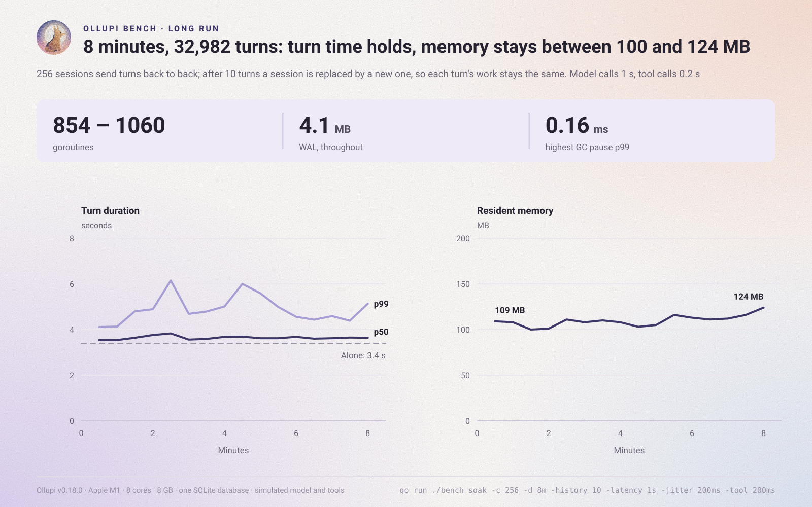

# Bench

Measures Ollupi's scheduling and persistence, not model quality. The engine is real — the host, the SQLite database, the scheduler, the gateway — and only the model and the tools are simulated. The simulated provider is reached through the OpenAI client and answers 429 when more requests are in flight than its quota allows. Unless an experiment says otherwise, a model call takes 5 s ± 2 s, a tool call 1 s, and a turn makes 3 model calls and 2 tool calls: 17 s when run alone.

Every number below was measured on Ollupi v0.18.0 on 2026-11-19, one run each, on an Apple M1 (8 cores, 8 GB) with one SQLite database. Raw output is in [results](results); the comparison with other harnesses is in [compare](compare/README.md). The figures are drawn by [docs/images/figures.py](../docs/images/figures.py).

## Results

| Question | Answer | Raw output |
|---|---|---|
| How does Ollupi compare with pi and DeepSeek Harness? | Least memory; the only one to finish a 3000-turn burst and to bring background results back after `kill -9`; slower than pi past 1024 sessions ([comparison](#comparison)) | `compare/results/results.txt` |
| How many sessions run at once before turns slow down? | 1536 at 5% over alone; at 4096, turns take 2.8 times as long, waiting for SQLite | `steady-*.txt` |
| What does a parked session cost? | 50,000 parked sessions: 34 MB resident memory, 7 KB of disk each | `parked.txt` |
| 3000 turns submitted at once, quota 256? | All complete, no 429, 1.04 times the time the quota allows | `burst.txt`, `burst.csv` |
| Does a long command hold up other sessions? | Not in the background: new sessions wait 10 ms, against 144 s with the command in its turn | `background*.txt` |
| What survives `kill -9`? | Every turn; no tool call runs twice; a standby takes over in 1.3 s | `crash*.txt`, `resume.txt` |
| Do more shards add capacity? | Yes, as far as one machine goes: the same 4096 sessions run 1.7 times as many turns a second on 4 shards as on 1; the router costs nothing measurable | `shards.txt` |
| Does one heavy user hold up the others? | Not with a per-user slot limit: the others wait 8 ms, against 206 s without | `users*.txt` |
| Do failures and slow model calls fail turns? | No: 5% of requests failing, or a long tail, fail no turn | `steady-faults.txt`, `steady-lognormal.txt` |
| Does it slow down over a long run? | No: 8 minutes, 33,000 turns, turn time and memory hold | `soak.txt`, `soak.csv` |
| What does a long history cost? | From 8 to 55 turns of history, a turn goes from 3.6 s to 15.7 s, waiting for SQLite | `soak-history.txt`, `soak-history.csv` |

### Comparison



Same simulated provider and the same driver for all four; Ollupi runs as a process of its own, reached over its protocol. Memory is phys_footprint of the process that hosts the sessions.

| | Ollupi | pi (SDK) | pi-durable | DeepSeek Harness |
|---|---|---|---|---|
| Memory per parked session | 14 KB | 90 KB | 64 KB | 147 KB |
| Memory, 2048 sessions running | 398 MB | 777 MB | 925 MB | 1371 MB |
| Turn p50 over alone, 2048 sessions running | +76% | +28% | +58% | +330% |
| 3000 turns at once, quota 256: completed | 3000 | 483 | 527 | 1764 |
| `kill -9` mid-run | Every turn completes; no tool call runs twice | Turns in progress stop | Every turn completes; no tool call runs twice | 980 of 1000 turns end interrupted |
| Background commands, `kill -9` while they run | 200 of 200 report back | No background calls | No background calls | 0 of 200 report back |

Ollupi takes the least memory and is the only one to complete every turn of a burst. Its turns are not the fastest under heavy load: from 1024 sessions they slow down more than pi's, waiting for the store's one SQLite connection (see [Capacity](#capacity)). pi (SDK), 1.5.2; pi-durable, 1.5.2; DeepSeek Harness, 0.2.2-rc.5. Method and every number are in [compare](compare/README.md).

### Capacity



Closed loop: each session starts its next turn as soon as the last ends, 3 turns each. Slots and model calls equal the sessions.

| Sessions | Turn p50 | p99 | Model calls/s | CPU (cores) | Resident memory | Waiting for SQLite per turn |
|---|---|---|---|---|---|---|
| 512 | 17.4 s | 21.6 s | 74 | 0.64 | 129 MB | 0.2 s |
| 1024 | 18.4 s | 24.6 s | 137 | 1.23 | 215 MB | 1.4 s |
| 1536 | 17.8 s | 22.4 s | 215 | 1.64 | 308 MB | 0.8 s |
| 2048 | 21.5 s | 27.1 s | 236 | 1.77 | 368 MB | 4.2 s |
| 3072 | 32.0 s | 43.8 s | 241 | 1.88 | 456 MB | 14.2 s |
| 4096 | 48.2 s | 69.8 s | 216 | 1.84 | 531 MB | 29.8 s |

The bottleneck is the database: the store keeps one SQLite connection (`pkg/sqlitedb`), and a turn makes 126 reads and 44 writes on it. A longer history makes it worse; see [Long run](#long-run). Above 1536 sessions, the time turns spend waiting for that connection is nearly all of the time they lose. An active session takes about 112 KB (the slope of resident memory from 512 to 4096 sessions) and a turn about 14 KB of disk.

### Memory

50,000 sessions parked waiting on their user hold 34 MB of resident memory (10 MB of heap) and 341 MB of database, about 7 KB each; the process idles at 0.1 ms of CPU per second, and turns run beside them take 5.10 s for 5 s of model latency. One Ollupi process per session, the per-agent isolation Ollupi replaces, takes 17.7 MB each before any container.

### Burst

3000 turns submitted at once, with 512 slots and the connection and the provider both at 256 requests. Ollupi holds the requests beyond the quota in its own queue: requests in flight peak at exactly 256, the provider answers no 429, no turn fails, and all complete in 182.9 s, where the quota allows 175.8 s. Harnesses that do not limit their requests send them all and rely on retries; see [the comparison](#comparison). `results/burst.csv` has the timeline, every 250 ms.

### Background calls



256 sessions, spread over 64 users, each run one turn whose tool call takes 30 s; 32 slots, and 32 commands at a time either way. Every second, a new session sends a 5 s turn. With the commands in the background, a new session's first model request waits 10 ms at p50 and its turn takes 5.1 s; with the commands in their turns, they hold all 32 slots, and the new session waits 144 s and its turn takes 149 s. The commands finish in about the same time either way: 243 s and 257 s, where 32 at a time allow 240 s.

### Recovery



500 sessions run tool calls, questions to the user, subagents and background calls, with model calls of 200 ms and tool calls of 300 ms, and the process is killed with `kill -9` 30 times at random: all 600 turns complete, no tool call runs twice, and of 110 calls cut off, none is run again. All 100 background calls report back; 58 report that they were cut off. A restart takes 29 ms at p50. With a 1.5 s lease and a standby waiting on the shard, 8 kills: all 480 turns complete and the standby takes over in 1.3 s at p50.

A restart with 10,000 sessions waiting and 500 running is ready in 8 ms and has every running turn's model request out again in 346 ms. Waking an idle session takes 3.7 ms with 10 turns of history, 8.6 ms with 100 and 89 ms with 1000.

### Users



One shard with 512 slots; 32 users keep 8 sessions busy each, and one user keeps 1024 busy, each user on a key of their own. With no per-user limit, the heavy user takes every slot and the others' turns wait 206 s at p50. With `UserSlots` at 64, the others wait 8 ms and their turns take 17.1 s, as alone. When the heavy user's key is over its quota at the provider, its 7,389 429s and 148 failed turns stay its own: the others get no 429.

### Shards

The same 4096 sessions, 64 to a user, spread over 1, 2 and 4 shards. Each shard is a `bench serve` process with a database of its own; clients reach them over the protocol through a router (`connsrouter`), which sends user N to shard N modulo their number. One more step reaches a single shard straight, without the router. Every process runs on the one test machine.

| | 1 shard, straight | 1 shard | 2 shards | 4 shards |
|---|---|---|---|---|
| Turns per second | 89.0 | 84.9 | 116.3 | 144.4 |
| Turn p50 | 37.2 s | 37.1 s | 28.1 s | 22.9 s |
| Turn p99 | 58.9 s | 61.7 s | 39.3 s | 29.6 s |
| CPU, shards | 2.13 | 1.94 | 3.42 | 4.81 |
| CPU, all processes | 2.31 | 2.15 | 3.80 | 5.34 |

No turn fails. More shards run more turns: 1.37 times as many on 2 shards and 1.70 times on 4, against 241 a second if every turn took its 17 s alone. Each shard has its own SQLite connection, so the wait that slows one shard (see [Capacity](#capacity)) is split among them. Past 2 shards the gain falls off because the machine runs out: at 4 shards all processes together use 5.3 cores, and the M1 has 4 performance cores beside 4 efficiency cores. Whether throughput grows in proportion on shards of their own machines is not measured. The router adds no measurable time (p50 37.1 s against 37.2 s straight) and uses 0.04–0.11 cores and 18 MB.

An earlier run of the same experiment (`shards-previous.txt`, without the CPU totals) gave 87.3, 87.8, 127.4 and 128.2 turns a second: the steps at 2 and 4 shards differ from this run by up to 12%.

### Faults and long tail

1024 sessions, with 5% of model requests answered 500 and other clients of the account holding up to 256 of the quota: no turn fails, and p99 is 25.0 s against 24.6 s without. 1536 sessions with log-normal model latency (median 5 s, σ = 0.6): no turn fails, p50 20.2 s, p99 43.1 s.

### Commands in a sandbox

1024 sessions whose tool calls each run `sleep 1` through `run_command`, up to 1024 processes at a time on 8 cores. With full access (no limits on commands), turn p50 is 34.1 s; within the macOS sandbox's limits (workspace write), 104.1 s, with 563 ms of CPU per turn spent starting sandboxed processes. The fake tool takes 18.4 s.

### Mixed load and subagents

256 sessions send turns, 20% of them handed to subagents, while 1000 scheduled jobs come due at once: off the peak, a user's turn waits 8 ms at p50 and 3.2 s at p99 for its first model request; the peak drains in 56.9 s; no turn fails, and the Jain fairness index of turn time across sessions is 0.975. 64 turns each spawning 8 subagents on 32 slots: all 576 turns complete in 1.19 times the floor, and every parent waiting on its subagents gives up its slot.

### Long run



256 sessions send turns back to back for 8 minutes, with 1 s model calls and 0.2 s tool calls (3.4 s alone). After 10 turns a session is replaced by a new one, so each turn's work stays the same and only time goes by. Over 32,982 turns, turn p50 stays between 3.5 s and 3.8 s, resident memory between 100 and 124 MB, goroutines between 854 and 1060, the WAL at 4.1 MB, and GC pause p99 within 0.16 ms.

`soak-history` runs the same load without replacing sessions, so each turn carries a longer history than the last: from 8 to 55 turns of history, turn p50 goes from 3.6 s to 15.7 s, and 12.2 s of the 15.7 is waiting for the database connection. A turn re-reads its history and writes on the same connection as every other turn.

### Connections

Idle client connections, one user each. Each adds about 50 KB of resident memory, 4 goroutines and one file descriptor to the shard, and 0.008 ms of CPU per second for pings; 8000 connections take 421 MB. Through a router, each adds 27–43 KB, 4 goroutines and 2 descriptors to the router. After the shard is killed and started again, 8000 clients reconnecting as the protocol says are all back in 83 s, and 4000 through a router in 44 s. The clients run on the same machine, so its limits on descriptors and ephemeral ports stop the test at 8000 (`kern.maxfilesperproc` and `net.inet.ip.portrange` on macOS; `ulimit -n` and `net.ipv4.ip_local_port_range` on Linux).

## Running

Nothing else should run on the machine during a measurement. [run.sh](run.sh) runs the experiments one at a time and enforces it: before each, it waits until Docker Desktop is not running, the lid is open, the CPU is at least 60% idle and no [comparison](compare/README.md) is running; it throws away a run the Mac slept through and runs it again. Each result is kept as `results/<experiment>.txt`, headed by the command, the commit, the time and the machine.

```bash
bench/run.sh                      # every experiment
bench/run.sh -l                   # list them with their commands
bench/run.sh steady-1024 crash    # only these
go test -tags sqlite_fts5 ./bench # each experiment at a size that ends in seconds, checking what it exists to show
```

| Experiment | Command (after `go run -tags sqlite_fts5 ./bench`) | Measures |
|---|---|---|
| `parked` | `parked -n 50000 -state waiting -latency 5s -rounds 3` | Memory and disk of parked sessions, and turns beside them |
| `isolated` | `isolated -k 20` | One process per session, the control |
| `steady-N` | `steady -c N` | Closed loop at N sessions |
| `steady-faults` | `steady -c 1024 -fail 0.05 -others 256` | Failing requests and a shared quota |
| `steady-lognormal` | `steady -c 1536 -sigma 0.6` | Long-tailed model latency |
| `steady-workspace-write`, `steady-full-access` | `steady -c 1024 -command workspace-write` (or `full-access`) | Tool calls as real commands through `run_command`, within the sandbox's limits or with full access |
| `burst` | `burst -n 3000 -slots 512 -calls 256 -latency 5s -jitter 2s -tool 1s -timeline results/burst.csv` | Many turns at once against a quota |
| `resume` | `resume` | Waking idle sessions; restarting with sessions waiting and running |
| `crash`, `crash-lease` | `crash -n 500 -kills 30`; `crash -n 400 -kills 8 -lease 1500ms` | Random `kill -9`; with a lease, a standby takes over |
| `background`, `background-foreground` | `background -mode background` (or `foreground`) | Long tool calls in the background, against the same calls in their turns |
| `mix` | `mix` | User turns, subagents and scheduled jobs together |
| `fanout` | `fanout` | More subagents than slots |
| `soak` | `soak -c 256 -d 8m -every 30s -history 10 -latency 1s -jitter 200ms -tool 200ms -csv results/soak.csv` | A long run, each turn's work the same |
| `soak-history` | `soak -c 256 -d 8m -every 30s -latency 1s -jitter 200ms -tool 200ms -csv results/soak-history.csv` | A long run, each session's history growing |
| `users`, `users-slots`, `users-limit` | `users`; `users -user-slots 64`; `users -user-slots 64 -heavy-calls 64 -heavy-limit 32` | Users with their own keys beside a heavy one; a per-user slot limit; the heavy key over its quota |
| `shards` | `shards -c 4096 -n 1,2,4 -direct` | The same sessions on 1, 2 and 4 shards behind a router, and on one shard straight |
| `conns`, `conns-router` | `conns -n 1000,2000,4000,8000 -storm`; `conns -n 1000,2000,4000 -router -storm` | Idle connections on a shard, straight or through a router, and their return after a restart |

Building needs SQLite's FTS5, hence `-tags sqlite_fts5`.
