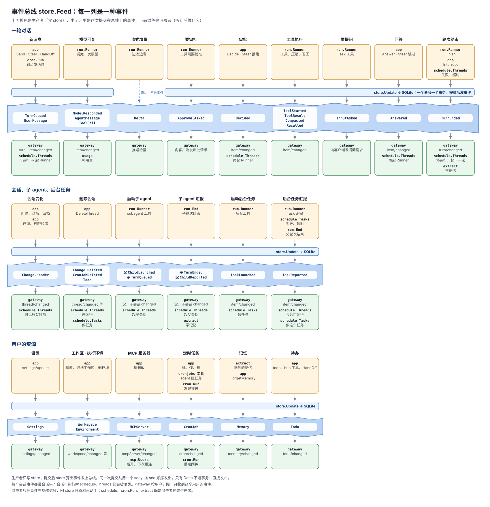
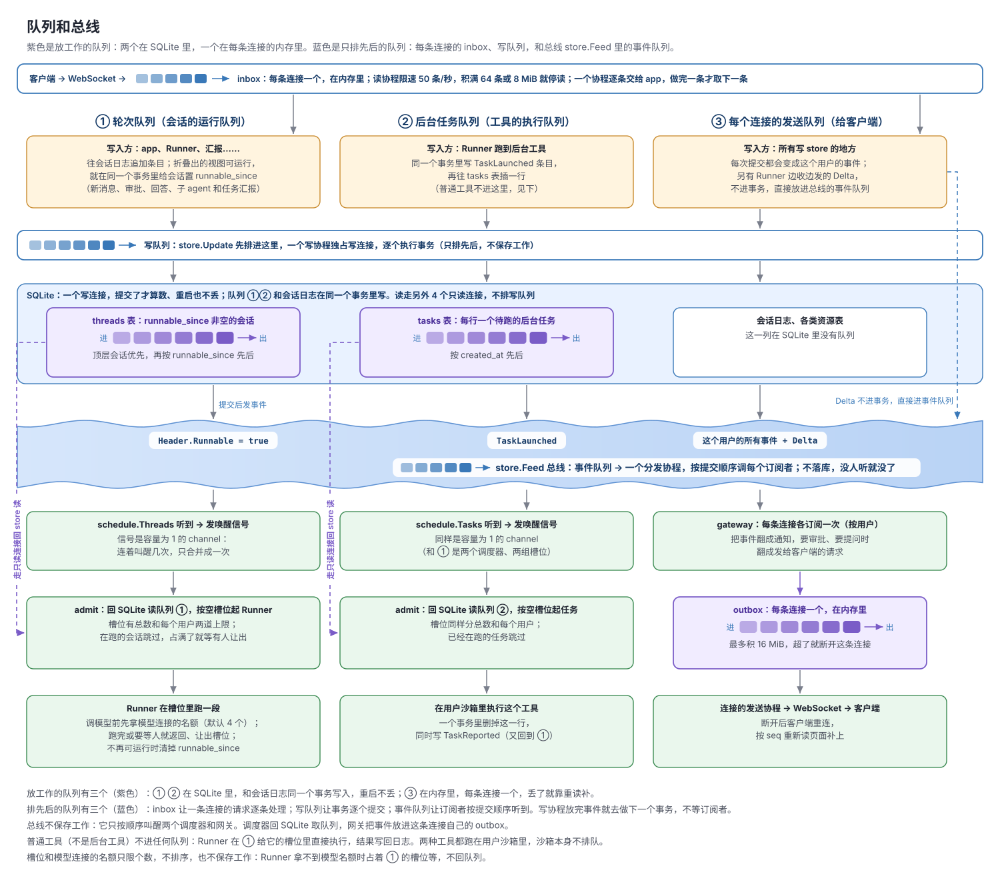

# 架构简图

一句话：所有改动都经 store 写进 SQLite；提交后 store 把变化发到总线 `store.Feed` 上，消费者听到后回 store 读，再做自己的事。

图里每一列是一种事件：上面是谁写出它，中间是它在总线上的名字，下面是谁听它、听到后做什么。

几点说明：

- **生产者不直接产生事件。** 它们只在 `store.Update` 里写；事务提交后，store 根据这次写了什么算出事件，再发到总线上。唯一的例外是模型的流式增量（Delta），由 Runner 直接放进总线的事件队列，不落库，但和提交的事件排在同一个队列里。
- **有的组件两边都在。** 调度器听到"可运行"会起 Runner，Runner 又是生产者，这就形成了驱动会话往前走的环。cron 和 extract 也是这样：听总线，也往 store 写。
- **消费者只把事件当唤醒信号。** 每个消费者都回 store 读当前状态再动手，所以漏一个、多一个事件都无害，重启时扫一遍就能补上。
- **不在总线上的：** 模型调用和工具执行是 Runner 内部的直接调用；用量行、记忆抽取进度等少数写入不发事件。

## 总线不是队列

`store.Feed` 只是广播。它内部有一个分发队列，只用来排定事件的先后：写协程按提交顺序把事件放进去，一个分发协程按顺序调用每个订阅者。它不落库，没人听的事件就没了，也不替谁保存要做的工作。要做的工作在下面三个队列里排着，三个队列彼此独立：

- **① 轮次队列**：`threads.runnable_since` 不为空的会话，在 SQLite 里。和会话日志在同一个事务里写，由 `schedule.Threads` 按自己的槽位取。
- **② 后台任务队列**：`tasks` 表，也在 SQLite 里。由另一个调度器 `schedule.Tasks` 用另一组槽位取。普通工具不进这个队列，Runner 在 ① 给它的槽位里直接执行。
- **③ 发送队列**：每条连接一个 `outbox`，在内存里。gateway 把总线上这个用户的事件翻成通知放进去，最多积 16 MiB，超了就断开这条连接，客户端重连后按 `seq` 重读补上。

两个调度器从总线上听到的只是"该看看了"，唤醒信号是容量为 1 的 channel，叫醒几次都只合并成一次。醒来后它们回 SQLite 读整个队列，所以漏掉事件也不会漏掉工作。

## 各部分做什么

| 部分 | 包 | 职责 |
|---|---|---|
| 接入 | `gateway`、`pkg/wshub`、`auth` | 认证连接；把请求交给 app；把事件推给客户端，等审批或回答时向客户端发请求 |
| 命令 | `app` | 校验后在一个事务里改状态：开会话、发消息、审批、回答、打断、交接、改设置和资源 |
| 存储 | `store`、`store/sqlite`、`conversation` | 唯一写路径；会话是只追加的日志，轮次和条目从日志折叠出来；提交后按 seq 发事件 |
| 调度 | `schedule` | 听到"可运行"就在槽位里起一次运行；后台任务另有一组槽位 |
| 执行 | `run`、`agent`、`prompt` | 读视图，`agent.Next` 决定下一步（调模型、跑工具、结束或等待），结果写回日志；要等人时就返回、让出槽位 |
| 模型 | `host`、`pkg/llm` | 部署提供一份模型目录，用户在里面选；目录可在运行中替换 |
| 工具 | `tool`、`tool/builtin/*`、`tool/mcp`、`policy`、`pkg/sandbox` | 权限按部署、用户、工作区、会话四层判定；命令和文件在用户沙箱里执行 |
| 后台 | `cron`、`extract`、`usage` | 定时任务到点发消息；轮次结束后学记忆；补用量记录 |
| 装配 | `host` | 打开 store，把上面这些接起来、一起运行 |
| 分片（可选） | `shard`、`router`、`catalog` | 多台机器时用租约占分片，router 按用户选分片 |

事件的细节（谁听什么、一轮怎么走）见 [event-flow.md](event-flow.md)；会话、轮次、条目的状态见 [lifecycle.md](lifecycle.md)。
