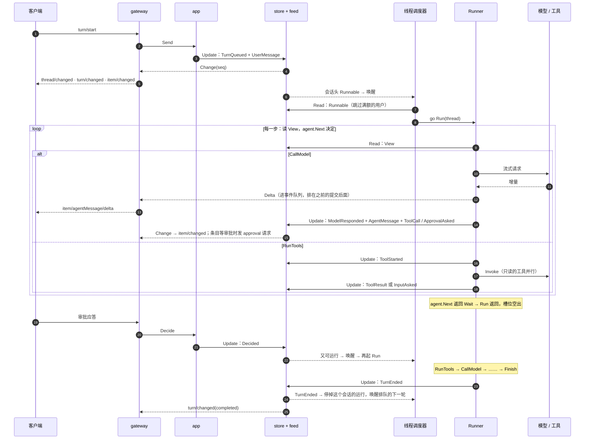
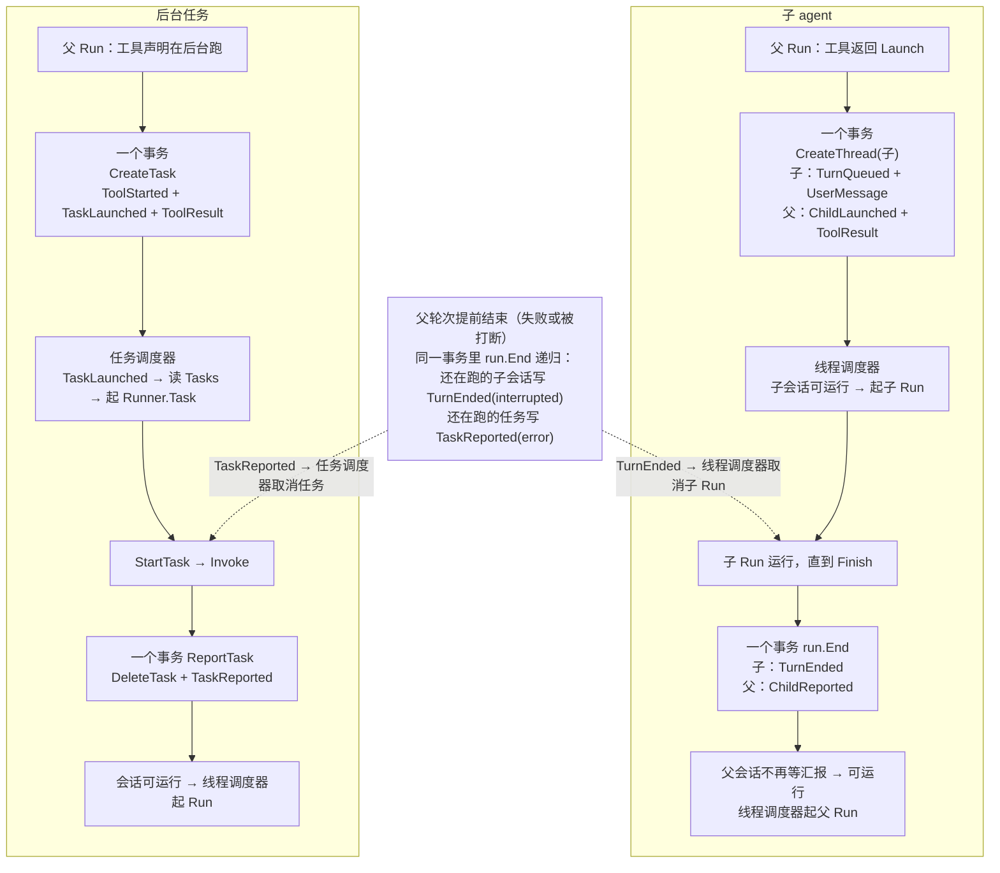

# 事件流

写路径、读路径和通知的总述见 [architecture.md](architecture.md)。本页讲事件本身：三个让引擎转起来的环、一轮在总线上怎么走、谁听什么，以及写入方和订阅方都要守的约定。feed 上的事件不是会话日志的副本，只是"某次提交改了这些东西"的通知。

代码在 [store/feed.go](../store/feed.go)、[store/sqlite/sqlite.go](../store/sqlite/sqlite.go)、[schedule/](../schedule/)、[run/](../run/)。

## 三个环

这三个环让引擎自己转起来：

- **会话环**：Runner 写日志 → 提交 → 线程调度器听到会话可运行 → 读出可运行的会话 → 起 Run。审批、回答、子 agent 汇报、后台任务汇报都只是往日志里追加一条记录，会话因此变回可运行，调度器听到后接着跑。
- **任务环**：Runner 写 `TaskLaunched` → 任务调度器听到 → 起 `Runner.Task` → 写 `TaskReported` → 会话环接手。
- **记忆环**：轮次结束 → 记忆抽取把这个用户标脏 → 读结束的轮次、调模型 → 写记忆 → `memory/changed` 发给客户端。

## 一轮对话

从用户发消息到轮次结束，中间等一次审批。

要点：

- Run 不在等待上阻塞。审批、回答、子 agent 汇报都在外面发生，Run 一遇到等待就返回，槽位让给别的会话。
- `Interrupt` 不去找正在跑的 Run。它只在事务里写 `TurnEnded`，调度器听到后取消这个会话的运行。`Steer` 也只是追加一条用户消息；正在等模型回答的 Run 发现期间来了新消息，就丢掉这次回答，重新读 View。
- 调度器自己出错或超时时，也通过写日志收尾：`Fail` 写 `TurnEnded(failed)`（会话），或写 `TaskReported(error)`（任务）。

## 子 agent 与后台任务

两者都是工具调用的异步分支。启动和汇报都是一次事务同时写两处，所以两边的事件共用一个 seq。

## 谁听什么

| 提交里出现的 | 订阅方 | 反应 |
|---|---|---|
| 任何 `Change` | gateway | `thread/changed`，加上变了的 `turn/changed`、`item/changed`，都带 seq；条目在等审批或回答时，向客户端发请求 |
| `Change` 的会话头 `Runnable` 为真 | 线程调度器 | 唤醒，读 `Runnable` 补满槽位 |
| `Change` 含 `TurnEnded`，或会话被删 | 线程调度器 | 取消这个会话正在跑的 Run |
| `Change` 含 `TaskLaunched` | 任务调度器 | 唤醒，读 `Tasks` 补满槽位 |
| `Change` 含 `TaskReported`，或会话被删 | 任务调度器 | 取消对应的任务 |
| `Change` 含 `TurnEnded` | 记忆抽取 | 这个用户标脏，稍后读它结束的轮次 |
| `Change` 含 `ModelResponded` | 用量记录 | 这个会话标脏，稍后补上用量行 |
| `Owned.MCPServer` / `MCPServerDeleted` | MCP 连接 | 关掉这个用户的连接，下次取工具时重连 |
| `Owned.CronJob` / `CronJobDeleted` | 定时任务 | 醒来提交到期的任务，再按最早的下次运行时间重定闹钟 |
| `Owned.Catalog`（不带用户） | host 的模型集合 | 换掉变了的模型客户端，没变的保留 |
| `Owned.Catalog`（不带用户） | gateway | 运营者的连接发 `catalog/changed`（含 key），每条连接发 `model/changed` |
| `Owned.User`（不带用户） | gateway | 运营者的连接和这个用户自己的连接发 `user/changed` |
| 其他 `Owned` | gateway | `settings/changed`、`workspace/changed`、`environment/changed`、`mcpServer/changed`、`cron/changed`、`memory/changed`、`todo/changed`、`skill/changed` |
| `Delta` | gateway | `item/agentMessage/delta`、`item/reasoning/textDelta` |

`Change` 来自会话的写入：`Append`、`CreateThread`、`UpdateThread`、`DeleteThread`。`Owned` 来自用户资源的写入：设置、工作区、执行环境、MCP 服务器、定时任务、记忆、待办、技能；模型目录（`SetCatalog`）和用户（`CreateUser`、`SetUserName`）的事件不带用户，每个订阅方都收到。`EnsureUser`、`SetMemoryState`、`PutUsage`、`PutPresence`、`CreateTask`、`StartTask`、`DeleteTask` 不发事件。后台任务之所以可见，是因为同一事务里追加了 `TaskLaunched`、`TaskReported` 这些条目。

## 约定

- **一个命令的改动在一个事务里提交。** 订阅方看到的每次提交都是完整的一步，不会看到做了一半的状态。比如中枢把工作交出去（`app.HandOff`）：新会话、第一条消息、待办的链接在同一次提交里出现，被拒绝时一样都不留下。
- **事件只是唤醒信号，真相在 store。** 订阅方不靠事件内容做决定：调度器读 `Runnable` / `Tasks`，抽取读 `EndedTurns`，用量读 `MissingUsage`。所以漏一个、多一个事件都无害。进程启动时，每个订阅方各扫一遍：调度器先唤醒自己一次，抽取把所有用户标脏，用量从头补。
- **事件按 seq 的顺序发出，靠队列而不是锁。** `store.Update` 把事务放进写队列，由一个写协程逐个执行；它提交一次，就把这次的事件放进 `store.Feed` 的事件队列，由一个分发协程按入队顺序调用订阅函数。只有写协程往里放提交的事件，所以事件天然按 seq 排好。写协程放完就去执行下一个事务，不等订阅函数；`Update` 自己要等到这次的事件发完才返回，所以调用方返回后，订阅方（比如客户端的出站队列）已经收到了。读走另外几个只读连接（WAL 下各读各的快照），不进写队列。
- **订阅函数不能阻塞。** 所有订阅函数都在同一个分发协程上调用：一个卡住，后面的事件都发不出去；事件队列积满后写协程也会停下。订阅函数只能记下要做的事、唤醒自己的循环，不能在里面调 `store.Update`（它要等这个分发协程，会死锁）。gateway 的出站队列有上限，客户端读得太慢就断开它。
- **Delta 不落库，但和提交排在同一个事件队列里。** 它没有 seq，断线期间的增量会丢，重连后用 `thread/read` 拿完整条目；在线时，它不会抢在之前的提交前面发出。
- **Delta 带 `offset`，客户端按它拼，`item/changed` 说了算。** `offset` 是这段增量在条目最终文本里的起点，单位是 UTF-16 码元（和 JS 字符串的 `length` 一致）。客户端的规则：
  - `offset` 不超过本地已有长度时，截到 `offset` 再接上这段；
  - `offset` 超过本地长度，说明中间漏了，丢掉这段，等 `item/changed`；
  - 收到这个条目的 `item/changed` 后，以其中的完整文本为准，之后再来的增量全部丢掉。

  这样重复、迟到、重连后重读都不会拼错。一次模型回调里同时有思考和正文时，会发成两条增量，各带各的 `offset`。
- **请求和响应不走 feed。** `thread/list`、`thread/read` 这类读接口直接读 store；`error` 通知由 gateway 直接发。
- **读结果和通知按 seq 合并。** 读接口在只读连接的一个快照上读，回复放进出站队列之前，分发协程可能已经把之后一次提交的通知放进去了，所以客户端可能先收到通知、后收到更旧的读结果。为此，客户端拿来做镜像的读结果（`thread/list`、`thread/read`、`thread/resume`、`workspace/list`、`environment/list`、`cron/list`、`mcpServer/list`、`memory/list`、`todo/list`、`settings/read`）都带上 `seq`，它是同一个读事务里最后一次提交的 seq；所有 `*/changed` 通知都带上自己那次提交的 seq。客户端的规则：
  - 读请求在途时，把相关的通知先存下来；
  - 回复到了，用读结果替换本地镜像，然后只应用存下的通知里 seq 比读结果大的；
  - 之后通知按 seq 顺序到达，seq 不超过读结果的直接丢掉。

  写接口的返回值不带 seq：`Update` 返回之前通知已经进了出站队列，镜像应以通知为准，不要应用写结果。
- **模型目录是部署的，用户的选择在设置里。** `Tx.SetCatalog` 整份替换 `providers` 和 `provider_models`；已经在调模型的轮次用原来的客户端跑完。用户选哪个模型开新会话、哪个模型学记忆，存在 `Settings.Model`、`Settings.LearnModel`，照常经事务提交、以 `settings/changed` 通知。记忆抽取每次处理一个用户时都重新读它的设置，不需要监听设置的变化。
- **只有这几处由时间驱动：** 定时任务按最早的下次运行时间定闹钟，最长一分钟醒一次核对时钟（Go 的计时器不计电脑睡眠的时间，归档的会话恢复时也没有定时任务事件）；抽取和用量失败后定时重试；shard 定时续租；wshub 定时 ping。
