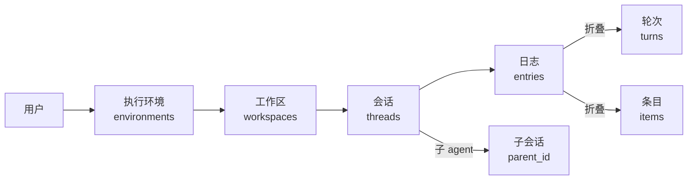
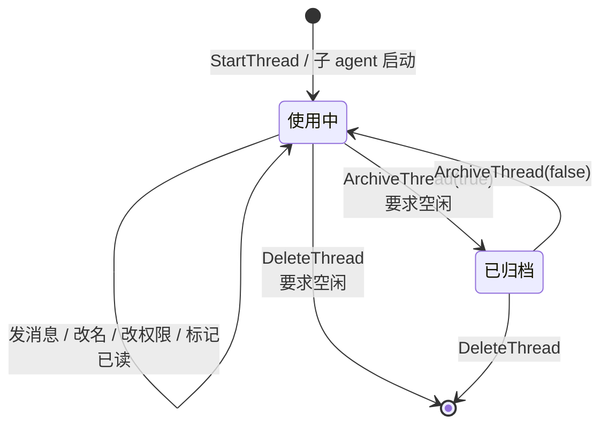
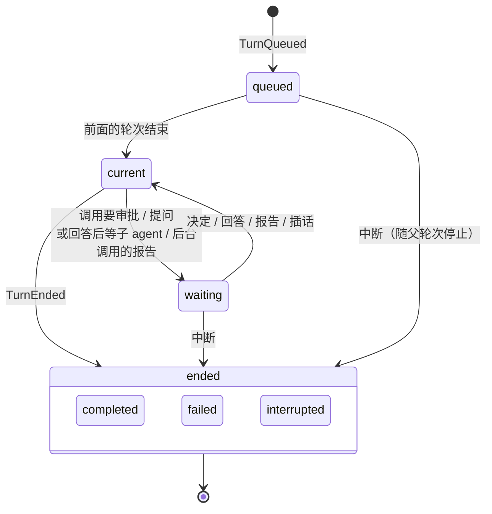
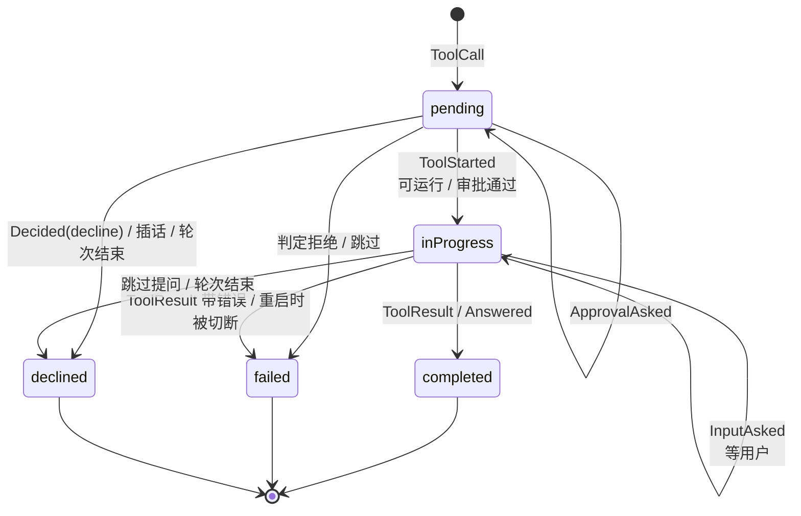

# 工作区、会话、轮次、条目

引擎里用户看得见的状态由四个概念组成：工作区（workspace）装着会话（thread），会话由一个个轮次（turn）组成，轮次里的每一步都是条目（item）。会话的轮次和条目不单独保存，它们是会话**日志**的投影：日志只追加、不修改，状态都从日志算出来。这一页讲每个概念是什么、怎样诞生、经过哪些状态、怎样结束，以及它们之间的约束。

日志怎样写、视图怎样读、变化怎样通知见 [architecture.md](architecture.md)。本页按当前代码写，面向贡献者。

| 概念 | 是什么 | 保存在 | 归属 | 怎样结束 |
|---|---|---|---|---|
| 工作区 | 某个执行环境里的一个文件夹，带一层权限设置 | `workspaces` | 用户和执行环境 | 只能归档，不能删除；临时工作区随环境一起删 |
| 会话 | 一段对话，在某个工作区里，运行在它所在的执行环境 | `threads`，日志在 `entries` | 用户；子会话还属于父会话的一个调用 | 归档或删除，二者都要求空闲 |
| 轮次 | 用户（或定时任务、父 agent）交给 agent 的一件事 | 日志的投影，物化在 `turns` | 会话 | `completed` / `failed` / `interrupted` |
| 条目 | 轮次里的一步：一条消息、一段思考、一次工具调用…… | 日志的投影，物化在 `items` | 会话和轮次 | `completed` / `failed` / `declined` |

## 工作区

工作区是某个执行环境里的一个文件夹。执行环境是部署提供的某种沙箱（`sandbox.Provider`，本机是其中一种）的一个实例，第一次用到时才打开；同一个路径在两个环境里是两个文件夹。每个会话都在一个工作区里，在工作区所在的环境里运行，工具调用在这个文件夹里执行；工作区的权限设置是权限分层里的一层（部署 → 用户 → 工作区 → 会话）。

每个执行环境都有一个临时工作区（`kind` 为 `scratch`），随环境一起建、一起删，`root` 为空，文件夹就是环境自己的文件夹。开会话时不指定工作区，会话就进所选环境（默认用户的第一个环境）的临时工作区。临时工作区不能归档（`app.ErrScratchWorkspace`），也不能移动（`app.ErrKeptFolder`）。

- **添加**：`app.AddWorkspace` 先让沙箱确认路径是个目录（`box.Directory`），再按文件夹去重：同一用户已有指向同一文件夹的工作区（`box.Same`）就用它，已归档的顺带恢复。
- **移动**：`app.MoveWorkspace` 把项目的文件夹搬到一个已存在且为空的目录，只改 `root`。会话、记忆、定时任务都按工作区 id 引用它。移动要求名下的会话都空闲（`Reader.WorkspaceBusy`）。开始移动是一次写入：在同一个事务里检查空闲，并在工作区上记下 `moving_to`（要搬去的目录）。排新轮次的事务也在事务里读它，看到正在移动就拒绝。两者都排在同一个写队列里，所以不会出现"刚检查完空闲，就排进来一个轮次"的情况。搬完（或者没搬成）再用一次写入改 `root`、清掉 `moving_to`，每次都会发 `workspace/changed`，客户端能看到 `movingTo`。进程在移动途中退出的话，host 启动时由 `app.SettleMoves` 收尾：原目录还在就留在原处，否则目标目录在就改成目标。
- **归档**：已归档的工作区不能新建会话，名下的会话也不能发新消息（`account.ErrWorkspaceArchived`）。
- **指令**：`app.UpdateWorkspaceInstructions` 给工作区一段指令（最多两万字）。这个工作区里每个会话、每个角色的系统提示词都带上它，放在角色规则之后（`# WORKSPACE INSTRUCTIONS`）。
- **工具来源**：`app.UpdateWorkspaceProviders` 给工作区开（`enabled`）或关（`disabled`）某些 provider 的工具，名字要是用户工具里有的 provider。部署可以把一些 provider 设成默认关闭（`host.Config.OptIn`）：它们只在 `enabled` 里写了它们的工作区出现，没挂工作区的会话里也没有。这一层排在工作区权限之后（`account.Layers`），对所有角色都生效；`disabled` 优先于 `enabled`。
- **类型**：工作区是项目（`project`）、中枢（`hub`）或临时（`scratch`）。项目是用户选的文件夹；中枢和临时工作区的文件夹由执行环境保管，不能移动（`app.ErrKeptFolder`）。中枢由 `app.StartHub` 建：在用户第一个环境替它保管的文件夹里（`Box.Folder("super-agent")`，本机是 `~/.ollupi/super-agent`），已有就返回它，归档了就恢复；每个用户只有一个。中枢默认关闭：部署打开 `host.Config.Hub` 才注册中枢工具，没有中枢工具时 `StartHub` 被拒绝（`app.ErrNoHub`）；会话不记这个类型，它在哪种工作区里，每一轮就按哪种选角色（见"轮次"）。
- **中枢**：中枢工作区里的会话以 `hub-main-agent` 运行。它不做项目里的活，用中枢专有的工具（`tool/builtin/hub`）把工作交给项目：`list_workspaces` 列出工作区；`start_conversation` 在一个项目工作区里新建会话并发出第一条消息，`send_message` 给一个项目工作区里的会话发消息，二者都走用户自己用的 `app.StartThread` / `app.Send`。发送者记在消息上，不写进正文：`app.Input.From` 是发消息的中枢会话，app 核对它是这个用户的会话后，把它的 id 和当时的标题记进用户消息（`conversation.UserMessage.From`、`Item.From`），协议里是这条消息的 `sentByThreadId`，`read_conversation` 里是它的 `from`；给模型看的消息头写成 `[sent <时间> by the hub conversation "<标题>" on the user's behalf]`，压缩摘要里列出的早先消息也注明。会话按它所在工作区的权限运行，中枢角色自带的规则放行这两个调用；`list_conversations` 默认列出中枢工作区里任何一个会话开过的会话（按 `items_calls` 索引从这些会话日志里的 `start_conversation` 调用找，`Reader.Calls`），也能按 id 或工作区查用户的任何会话，给出状态、排队的轮次、最后一轮怎样结束、是否已读和最后回答的开头；`read_conversation` 给出一个会话最近几轮的消息。中枢不能把工作交给中枢工作区，也不能启动子 agent 或用浏览器；其他角色都没有这些工具。
- **中枢的待办**：中枢的待办和已完成事项存在引擎里，`todos` 表（迁移 0012）是唯一的真相：一条待办有 id、标题、状态（`open` 未开始 / `handed` 已交给会话 / `done` 完成 / `dropped` 放弃）、指向的项目工作区与会话、备注、完成时的一句话结果和结束时间（`ended_at`，归档按它分月）。中枢会话用 `add_todo` / `update_todo` / `list_todos` 维护它们，不写文件，也不读 `TODO.md`；交给项目时用 `start_conversation` 的 `todo` 参数：`app.HandOff` 在一个事务里新建会话、发出第一条消息、链接待办并置 `handed`，任何一步被拒绝，三样都不留下。待办跟着用户走，不跟着文件夹：中枢换了工作区，待办还在。删掉一个会话时，挂在它上面的 `handed` 待办退回 `open` 并解除链接。桌面端用 `todo/list` 读、`todo/update` 改，每次 Add/Put 成功都收到 `todo/changed`。早先记在中枢工作区根目录 `TODO.md` 和 `done/*.md` 里的计划在第一次读待办时一次性导入，`TODO.md` 随后改名为 `TODO.md.imported-<年-月-日>`；`done/*.md` 原样留着，引擎不再读写这些文件。

代码：[account/account.go](../account/account.go)、[app/owned.go](../app/owned.go)、[tool/builtin/hub/](../tool/builtin/hub/)、[store/sqlite/owned.go](../store/sqlite/owned.go)。

## 会话

会话是一段对话。它在一个工作区里，带一层自己的权限设置。

- **顶层会话**：用户通过 `app.StartThread` 创建，出现在会话列表里。
- **子会话**：子 agent 的会话。父会话里启动它的调用结束时，runner 在同一事务里创建子会话、给它排上第一个轮次和任务消息（`run.launch`）。它记着 `parent_id`、`parent_item` 和它的角色（`role`，即启动它的工具；顶层会话的角色每一轮现选，这一列为空），继承父会话的工作区和权限设置（启动时把父会话的会话级权限复制一份，之后两个会话各改各的，已批准过的"总是允许"仍按所在工作区共享）。用户可以像对顶层会话一样给它发消息、插话、中断，这些轮次沿用它的角色。
- **子会话**：`general-sub-agent`、`browser-sub-agent`、`design-sub-agent`（画图/视觉：插图、图表、示意图、界面稿，以及 logo、海报、封面、横幅这类成品图）、`codebase-sub-agent`（通读项目、分析架构）、`frontend-sub-agent`（前端编程：界面、组件、样式，动手就打开浏览器看渲染）、`backend-sub-agent`（后端编程：接口、数据、迁移、测试）、`writing-sub-agent`（写文章：草稿、邮件、文档，贴合用户本人的语气）、`research-sub-agent`（搜集信息：读一手来源、核对、每条结论带出处）、`verify-sub-agent`（验证做完的活：跑构建和全部测试、亲手试行为和该失败的情况，每条标准给出通过、失败或没查到及证据；拿不到改文件的工具，什么都不修）汇报：父轮次等它，它只汇报启动它的那一轮，报告写进启动它的轮次；它不出现在会话列表和搜索里，随父会话一起删除。

- **当前轮次**：日志里第一个还没结束的轮次（`View.Active`）。其余没结束的排在它后面（`View.Behind`）。同一会话任何时刻只运行当前轮次。
- **会话状态**从视图算出（`View.Status`）：没有当前轮次是 `idle`；当前轮次在等审批或回答是 `waitingOnApproval` / `waitingOnUserInput`；否则是 `active`。
- **可运行**：有当前轮次且它不在等任何东西（`View.Runnable`）。store 记下它变成可运行的时刻，调度器按这个时刻先后取会话。
- **未读**：顶层会话的轮次结束时写 `replied_at`；标记已读时写 `read_at`。
- **归档、删除**：要求会话空闲。已归档的会话不能发新消息（`app.ErrThreadArchived`）。删除连同日志、子会话、它们的定时任务和附件一起删掉。

代码：[app/threads.go](../app/threads.go)、[store/sqlite/conversations.go](../store/sqlite/conversations.go)。

## 轮次

轮次是交给 agent 的一件事。它有三个来源，都是追加 `TurnQueued` 和一条 `UserMessage`：

| 来源 | 写入 |
|---|---|
| 用户发消息 | `app.Send`，每条消息一个轮次 |
| 定时任务到点 | `cron.Run` 调 `app.Scheduled`，`TurnQueued.CronJob` 记着任务 |
| 子 agent 被启动 | `run.launch`，和父会话里结束启动调用的记录在同一个事务里 |

`TurnQueued.Role` 是这一轮的角色：子会话沿用它的 `role`；中枢工作区里的会话用 `hub-main-agent`；其余按这一轮的模型选 `full-main-agent` 或 `compact-main-agent`（`app.queue`）。

会话空闲时，新轮次就是当前轮次；会话忙时它排在后面，等前面的轮次结束。排队上限是 20 个轮次（`maxQueued`）。用户想把话说给正在运行的轮次，用 `app.Steer`：消息追加进当前轮次，agent 在下一步读到它。

### 状态

轮次没有状态列。它要么已结束（`TurnEnded` 记着 `completed` / `failed` / `interrupted` 和原因），要么没结束；没结束的轮次是当前轮次，或排在后面。当前轮次在做什么，看它的条目：

| 看到的 | 意思 | 调度器 |
|---|---|---|
| 不在等任何东西 | 可运行 | 有空槽位就运行它 |
| 有调用在等审批 / 等回答 | 等用户 | 不运行；用户决定或回答后又可运行 |
| 已经回答，它在等的子 agent 或后台调用还没全部汇报 | 等报告（`WaitReports`，值 `reports`） | 不运行；每个报告到达时又可运行 |

谁让轮次前进：

- **调度**：`schedule.Scheduler` 订阅 feed。有会话变得可运行，它从 `Reader.Runnable` 取出等得最久的（用户自己的会话排在子会话前面），在总槽位和每用户槽位以内交给 runner（`schedule.Threads(runner.Run)`；`host.Config` 的 `Slots` 默认 32，`UserSlots` 默认等于 `Slots`，`RunLimit` 默认四小时）。后台调用由另一个调度器运行（`schedule.Tasks(runner.Task)`）：它从 `tasks` 表按创建先后取，限额另算，`TaskSlots` 默认 32，`UserTaskSlots` 默认 4，`TaskLimit` 默认一小时。在轮次里执行的调用占着轮次的槽位；后台调用不占。槽位只在内存里，重启后从 store 重新取。
- **运行**：`run.Runner.Run` 每一步重新读日志，问 `agent.Next` 下一步做什么，做完把结果追加回日志，直到轮次要等或结束：
  - `CallModel`：先在需要时追加记忆（`Recalled`）或压缩（`Compacted`），再请求模型；流式文字作为增量发到 feed（不落库），回复、它的消息和它的每个调用在一次提交里写下。每个调用写下时已经过权限判定：直接可运行、要问用户（`ApprovalAsked`），或被拒绝（`ToolResult` 带错误）。
  - `RunTools`：只读的调用一起执行，其余一次一个；先追加 `ToolStarted`，执行完追加结果。工具的结果也可以是一个问题（`InputAsked`）或要启动的子 agent。工具声明 `Background`（`never` / `optional` / `always`）；`run_command` 和 `claude` 是 `optional`，模型传 `background: true` 时这次调用就成为后台调用。后台调用从不和只读调用并行成组；一个事务里追加 `ToolStarted`、`TaskLaunched` 和一条说明它已开始的 `ToolResult`，并在 `tasks` 表里记一行，轮次接着往下走（`run.launchTask`）。后台调用跑完，结果作为 `TaskReported` 写回启动它的轮次，同一事务删掉那一行（`run.ReportTask`）。
  - `SkipTools`：用户拒绝了某个调用、或预算用完后，剩下的调用不执行，记为跳过。
  - `Finish`：轮次已经回答，追加 `TurnEnded{completed}`；父轮次在等的子会话，它被启动的那一轮还在同一事务里把回答作为报告写进父轮次（`ChildReported`）。
  - `Wait`：让出槽位。
- **结束**：`run.End` 结束一个轮次：先关掉它还没结束的调用（等回答的记为跳过，其余记为被拒绝），再停掉它在等、还没汇报的子 agent（不等的照常运行），把还没汇报的后台调用记为随轮次停止并汇报（调度器随之取消它们的运行），最后追加 `TurnEnded`。子会话被启动的那一轮结束时，如果父轮次在等它，就向父轮次汇报；之后的轮次不汇报。
- **中断**：`app.Interrupt` 就是 `run.End(interrupted)`。调度器在 feed 上看到正在运行的会话的轮次结束了，取消对应的运行。
- **失败**：运行出错或超过时限（默认四小时），调度器在让出槽位之前用 `run.End(failed)` 结束轮次。
- **重启恢复**：没有单独的恢复流程。runner 接手一个会话时，先把上一次运行留下的、已开始未结束的调用（`ToolStarted` 之后没有结果）记为被切断：它可能已经生效，agent 被提示先核实再重试，绝不会自动执行两次。后台调用也一样：调度器再取到一个上一个进程已经开始的后台调用（`tasks` 行有 `started_at`），不再执行，直接汇报它被切断（`run/tools.go` 的 `strandedTask`）。

定时任务的轮次和用户的轮次一样排队。上一次运行还排在别的轮次后面时，这一次跳过且不计数（`cron.send`）。

代码：[agent/agent.go](../agent/agent.go)、[run/](../run/)、[schedule/schedule.go](../schedule/schedule.go)、[app/turns.go](../app/turns.go)、[cron/cron.go](../cron/cron.go)。

## 条目

条目是轮次里的一步，由一条或几条日志记录折叠而成：一次工具调用从 `ToolCall` 开始，依次可能有 `ApprovalAsked`、`Decided`、`ToolStarted`、`InputAsked`、`Answered`、`ChildLaunched` 或 `TaskLaunched`，到 `ToolResult` 结束。

### 类型

| 类型 | 由哪条记录开始 | 含义 |
|---|---|---|
| `userMessage` | `UserMessage` | 用户消息：开启轮次的消息、插话、子 agent 的任务 |
| `agentMessage` | `AgentMessage` | 模型回答的正文 |
| `reasoning` | `Reasoning` | 模型的思考内容 |
| `toolCall` | `ToolCall` | 一次工具调用，参数、计划、审批、提问、结果都折叠在这一个条目里 |
| `contextCompaction` | `Compacted` | 一次上下文压缩，`text` 是摘要 |
| `memoryContext` | `Recalled` | 这一轮召回的记忆 |
| `notice` | `Notice` | 运行时告诉模型的话，比如工具为什么停了 |
| `error` | `ModelFailed` | 模型调用失败 |
| `agentReport` | `ChildReported` / `TaskReported` | 一个子 agent 或一个后台调用的报告，送回启动它的轮次；后台调用的报告带 `taskId` |

### 状态

| 状态 | 含义 |
|---|---|
| `pending` | 调用已记下、未执行，或在等审批 |
| `inProgress` | 调用已开始执行，或在等用户回答 |
| `completed` | 成功 |
| `failed` | 失败，`error` 写原因 |
| `declined` | 用户拒绝了这次调用、跳过了提问，或轮次结束时它还没执行 |

消息、思考、报告等写下时就已结束；报告带着结果是 `completed`，带着错误（比如随轮次停止、被切断、超过时限）是 `failed`。后台调用的调用条目在开始时就是 `completed`，它的 `ToolResult` 只说明已开始；真正的结果是之后单独的一条报告，可能失败。工具调用：

### 写入约束

`conversation.Check` 是唯一的守门人：

- 已结束的轮次不能再追加任何记录；还有调用没结束时不能追加 `TurnEnded`。
- 排在后面的轮次只能追加用户消息和 `TurnEnded`；其余记录只能写给当前轮次。
- 新条目要用新的 id；调用的每一步都要接在它当前的状态之后（比如只有在等审批的调用才能 `Decided`，只有在等回答的调用才能 `Answered`）。
- 记录写下后不再修改；审批依据的参数和计划（`Prepared`）就是 `ToolCall` 记下的那份，不会被悄悄换掉。

代码：[conversation/check.go](../conversation/check.go)、[conversation/view.go](../conversation/view.go)。

## 四者之间的约束

| 操作 | 要求 | 对下层的影响 |
|---|---|---|
| 归档工作区 | 无 | 不能新建会话，名下会话不能发新消息 |
| 移动工作区 | 名下会话都空闲 | 只改 `root`，其余都按 id 引用 |
| 归档会话 | 空闲 | 不能发新消息 |
| 删除会话 | 空闲 | 日志、子会话、定时任务、附件一起删除 |
| 结束轮次 | 有当前轮次 | 还没结束的调用先关掉；它在等的子 agent 被停掉并汇报，不等的照常运行；还没汇报的后台调用记为随轮次停止并被取消；子会话被启动的那一轮向在等它的父轮次汇报；排在后面的轮次成为当前轮次 |
| 追加记录 | 通过 `conversation.Check` | 可能让会话变得可运行，调度器从 feed 得知 |
