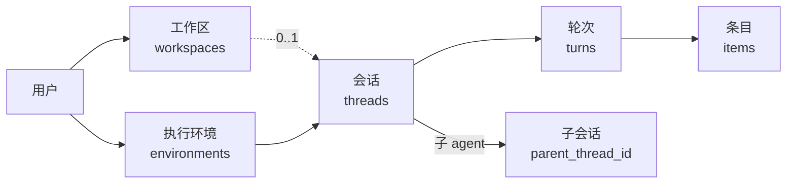
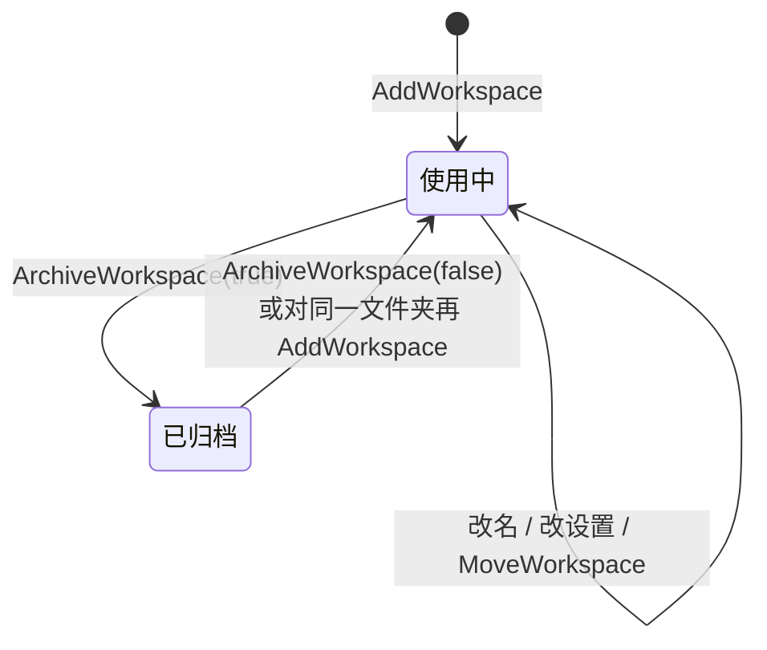
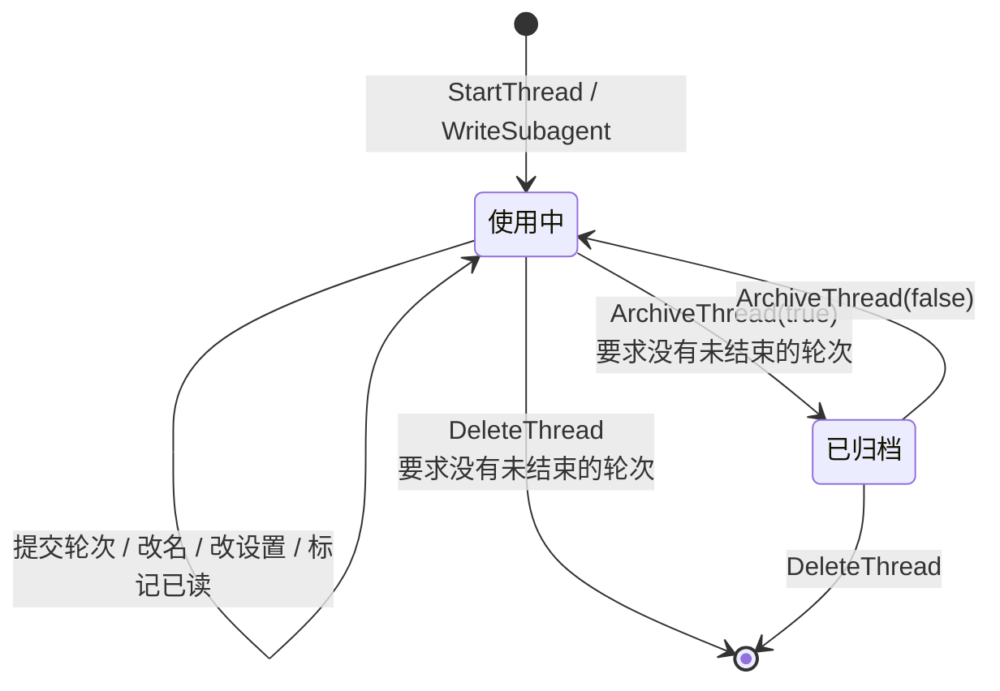
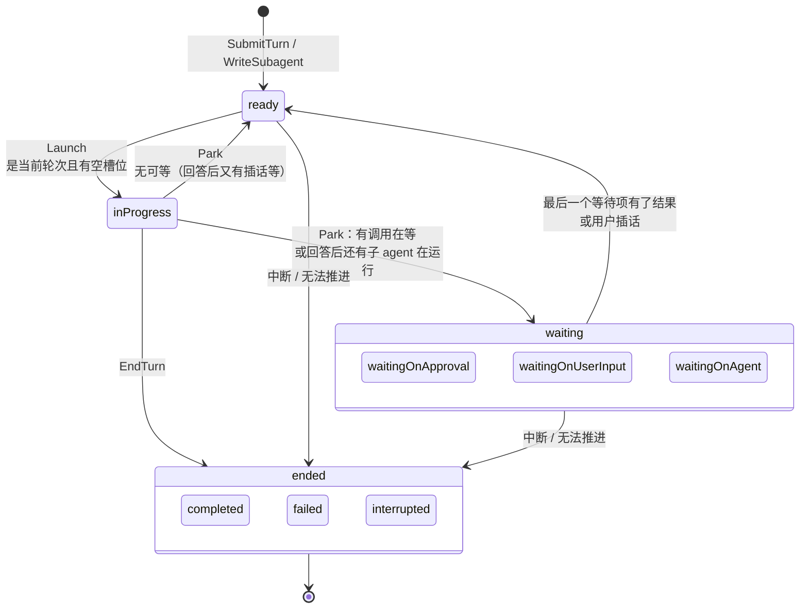
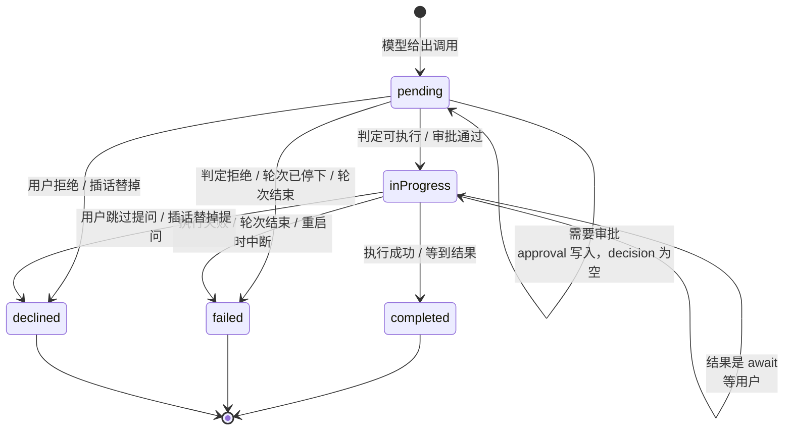

# 工作区、会话、轮次、条目

引擎里用户看得见的状态由四个概念组成：工作区（workspace）装着会话（thread），会话由一个个轮次（turn）组成，轮次里的每一步都记成条目（item）。四者都存在分片的 SQLite 里，进程内存只保留正在运行的部分。这一页讲每个概念是什么、怎样诞生、经过哪些状态、怎样结束，以及它们之间的约束。

本页按当前代码写，面向贡献者。对外的完整文档在 [ollupi-docs](https://github.com/0xfakeSpike/ollupi-docs) 的 `docs/engine/`（`persistence`、`execution`、`workspace`），那里描述的是 `engine.json` 记的引擎版本。

| 概念 | 是什么 | 表 | 归属 | 怎样结束 |
|---|---|---|---|---|
| 工作区 | 用户沙箱里的一个项目文件夹，带一层权限设置 | `workspaces` | 用户 | 只能归档，不能删除 |
| 会话 | 一段对话，运行在某个环境、某个工作区里 | `threads` | 用户；子会话还属于父会话的一个调用 | 归档或删除，二者都要求没有未结束的轮次 |
| 轮次 | 用户（或定时任务、父 agent）交给 agent 的一件事 | `turns` | 会话 | `completed` / `failed` / `interrupted` |
| 条目 | 轮次里的一步：一条消息、一段思考、一次工具调用…… | `items` | 会话和轮次 | `completed` / `failed` / `declined` |

## 工作区

工作区是用户沙箱（`sandbox.Box`）里的一个文件夹。会话的工具调用在这个文件夹里运行，工作区的权限设置是权限分层里的一层（默认 → 工作区 → 会话）。会话也可以不挂工作区（`workspace_id` 为空）。

字段要点：`root_path` 在同一用户下唯一（`workspaces_user_root`）；`settings` 是这一层的权限设置；`archived_at` 非空表示已归档。

- **添加**：`service.AddWorkspace` 先让沙箱确认路径是个目录（`box.Directory`），再按文件夹去重。同一用户已有指向同一文件夹的工作区（`box.Same`）就返回它，已归档的会顺带恢复，不会再建一个。
- **移动**：`service.MoveWorkspace` 把文件夹搬到一个已存在且为空的目录，只改 `root_path`。会话、记忆、定时任务都按工作区 id 引用它，所以不用改别的行。移动要求工作区空闲：它名下的会话没有未结束的轮次（`db.WorkspaceBusy`）。移动期间 `sv.moving` 拦住新轮次，检查和占用在同一把锁下完成。
- **归档**：已归档的工作区不能新建会话（`StartThread`），名下的会话也不能提交新轮次（`service.record` 里的 `usable`）。工作区没有删除操作，因为会话、记忆、定时任务都挂在它的 id 上。

代码：[repo/db/workspaces.go](../repo/db/workspaces.go)、[agent/service/workspaces.go](../agent/service/workspaces.go)。

## 会话

会话是一段对话。它运行在一个执行环境里（`environment_id`，为空时用默认环境），可选地挂在一个工作区上，带一层自己的权限设置。会话有两种：

- **顶层会话**：用户通过 `StartThread` 创建，出现在会话列表里（`threads_list` 只收 `parent_thread_id IS NULL` 的行）。
- **子会话**：子 agent 的会话，由父会话里的一次工具调用通过 `db.WriteSubagent` 写出。它记着 `parent_thread_id` 和 `parent_item_id`，继承父会话的工作区和环境。它不接受用户提交的轮次（`ErrSubagentThread`），父会话删除时一起删除（外键级联）。

- **当前轮次**：会话的当前轮次是它 seq 最小、还没结束的那个轮次（`db.ActiveTurn`、`ThreadState.ActiveTurn`）。其余未结束的轮次排在它后面（`ThreadState.Behind`）。同一会话任何时刻只运行当前轮次。
- **会话状态**不是一列，而是从当前轮次读出来的（`event.ThreadStatus`）：没有当前轮次是 `idle`；当前轮次在等审批或等回答，或者它启动的、还在运行的子 agent 正在等人，就是 `waitingOnApproval` / `waitingOnUserInput`；其余是 `active`。
- **未读**：一个轮次结束时写 `replied_at`；用户标记已读时写 `read_at`。`replied_at` 晚于 `read_at` 就是未读（`ThreadRow.Unread`）。
- **归档**：要求会话没有未结束的轮次（`CheckIdle`）。已归档的会话不能提交新轮次（`ErrThreadArchived`）。
- **删除**：同样要求空闲。删除会级联删掉它的轮次、条目和子会话，再删掉它的附件。

代码：[repo/db/threads.go](../repo/db/threads.go)、[agent/service/threads.go](../agent/service/threads.go)。

## 轮次

轮次是交给 agent 的一件事。它有三个来源：

| 来源 | 写入 | 第一个条目 |
|---|---|---|
| 用户发消息 | `service.StartTurn` → `db.SubmitTurn` | `userMessage` |
| 定时任务到点 | `service.StartScheduledTurn` → `db.SubmitTurn`（`cron_job_id` 非空） | `userMessage` |
| 子 agent 被调用 | `subagent.Invoke` → `db.WriteSubagent` | `userMessage`（任务） |

轮次一写入就是 `ready`，第一条消息也在同一个事务里写好。轮次自己不存消息内容，它的消息就是它的 `userMessage` 条目。

会话正忙时发来的消息不各开一个轮次，而是合并进同一个等待中的轮次（`db.SubmitTurn` 返回的 `Submission`）：

- 会话空闲：消息开启当前轮次（`Started`），服务端发 `turn/started`。
- 会话忙，最后一个轮次不是用户在排队的轮次：消息开启一个排在后面的新轮次（`Queued`），服务端发 `turn/queued`。
- 会话忙，最后一个轮次正是用户在排队的轮次：消息并入它（`Joined`）。这个轮次还没运行过，所以换用最新那条消息的模型和角色，服务端再发一次 `turn/queued`，带上它现在的样子。

等前一个轮次结束、排队的轮次成为当前轮次时，服务端发 `turn/started`，主 agent 一次读到排队的全部消息，只回一次。排队上限按消息数算（`maxQueuedMessages`，20 条，`db.QueuedMessages`）。定时任务的轮次不并入用户的消息，也不接收用户的消息：它有自己的"上一次还在排队就跳过"规则。

### 状态

| 状态 | 含义 | 占槽位 |
|---|---|---|
| `ready` | 等槽位；不是当前轮次时，等前面的轮次结束 | 否 |
| `inProgress` | 正在一个槽位里运行 | 是 |
| `waitingOnApproval` | 等用户审批一个工具调用 | 否 |
| `waitingOnUserInput` | 等用户回答 `request_user_input` | 否 |
| `waitingOnAgent` | 已经回答，等它启动的子 agent 全部结束 | 否 |
| `completed` | 结束：有最终回答 | 否 |
| `failed` | 结束：出错 | 否 |
| `interrupted` | 结束：被中断，或随父轮次一起停止 | 否 |

各转换在哪里发生：

- **拿到槽位**：调度循环每一步之后调用 `admit`，用 `db.ReadyThreads` 取出当前轮次为 `ready` 的会话（顶层会话优先，再按提交先后）。`reconcile` 再检查一次，然后 `db.Launch` 把它改成 `inProgress`。`ReadyThreads` 和 `Launch` 都带着条件 `firstOpen`：前面没有未结束的轮次。所以当前轮次在等审批时，排在后面的轮次不会抢先运行。唯一索引 `turns_one_running` 保证每个会话最多一个 `inProgress`。
- **离开槽位**：一次运行结束后，如果轮次既没结束也没出错，`db.Park` 按这一轮未结束的工具调用算出新状态（`waitingOn`）。等审批优先，其次等回答，因为这两样只有人能给；什么都不等就是 `ready`。
- **回答之后**：运行给出最终回答时，`db.AfterAnswer` 决定下一步。回答之后又来了输入（插话、子 agent 的报告），轮次回到 `ready`，接着回答；它启动的子 agent 还有在运行的（`db.RunningSubagents`），轮次进入 `waitingOnAgent`，因为一个轮次要等它的子 agent 全部结束才能结束；都不是，轮次才结束为 `completed`，这个判断和结束在同一次写入里，所以判断之后到来的插话不会落进已经结束的轮次。
- **解除等待**：写入工具调用条目时（`recordIn`），如果当前轮次在等审批或回答，就在同一事务里重算状态（`settleStatus`）。还有等待项时状态不变，全部有了结果就回到 `ready`。审批和回答都来自用户。`waitingOnAgent` 的解除在子 agent 那一侧：子 agent 的轮次结束时写入报告，如果它是最后一个还在运行的，父轮次回到 `ready`。
- **插话**：`service.SteerTurn` 把用户消息写进当前轮次（`db.Steer`）。轮次在等审批或回答时，这条消息替代它们：在等的调用和还没执行的调用记为 `declined`，轮次回到 `ready`，下一次运行读到这条消息。轮次在等子 agent 时，它直接回到 `ready`：主 agent 回复用户，子 agent 继续运行，回复完再回到 `waitingOnAgent`。
- **结束**：`orchestrator.endTurn` → `db.EndTurn`。轮次写上结束状态和 `completed_at`；它名下还没结束的条目一律记为 `failed`（"the turn ended before this item finished"）；会话的 `replied_at` 更新。如果这是子会话的轮次，同一事务里把报告写进父轮次（`reportToParent`）。如果后面还有轮次，排在第一的就成了当前轮次，并发出 `turn/started`。轮次因中断或出错而结束时，它启动的、还在运行的子 agent 被一起停止（`stopSubagent`），它们的报告不再写回。
- **中断**：`orchestrator.Interrupt` 中断当前轮次。在槽位里的取消运行，结束为 `interrupted`；不在槽位里的直接结束。排在后面的轮次不受影响，接着运行。
- **重启恢复**：进程启动时 `recover` 找出可能被卡住的会话（`db.StrandedThreads`：在 `inProgress` 的轮次；子 agent 的报告和它的结束在同一个事务里，不会漏报）。`RecoverItems` 把运行到一半的条目记为 `failed`，`inProgress` 的轮次 `Park` 回去，再逐个 `reconcile`。`ready` 的轮次不用恢复，`admit` 会照常取到。

子 agent 是引擎里唯一的异步工作：要做得久的事，比如下载或长构建，主 agent 派一个子 agent 去做。启动它的调用当场完成，结果里是子会话的 id；子 agent 的报告在它结束时作为一条 `agentReport` 条目回到启动它的轮次。具体是：

1. `subagent.Invoke` 调 `WriteSubagent` 写出子会话和一个 `ready` 的首个轮次，再通知编排器（`SubagentStarted`），后者发 `thread/started`、`turn/started`，子轮次像其他轮次一样拿槽位运行，和父轮次并行。
2. 父轮次继续运行，可以做别的事，也可以先回答；回答时子 agent 还在运行，就进入 `waitingOnAgent`。
3. 用户这时发消息（插话），父轮次回到 `ready`，主 agent 回复后再回到 `waitingOnAgent`。
4. 每个子 agent 结束时，`db.EndTurn` 在同一事务里把报告写进父轮次：完成的写它的最终回答，失败或被停止的写原因。最后一个结束的子 agent 把等待中的父轮次改回 `ready`，主 agent 读到全部报告后再回答。
5. 子 agent 用 `update_plan` 记录进度。客户端从子会话的 `parentItemId` 找到启动它的调用，把子会话的计划和状态显示在那里。

定时任务提交的轮次和用户的轮次一样排队、一样按先后拿槽位，但总是一个单独的轮次。上一次运行还排在别的轮次后面时，这一次跳过（`db.HasTurnBehind`）。

代码：[repo/db/turns.go](../repo/db/turns.go)、[agent/orchestrator/schedule.go](../agent/orchestrator/schedule.go)、[agent/orchestrator/run.go](../agent/orchestrator/run.go)、[agent/service/turns.go](../agent/service/turns.go)。

## 条目

条目是轮次里的一步。一次运行读出会话的条目拼成提示词，模型的输出和工具的结果又写成新的条目；每一步都先写库再继续，所以进程任何时刻退出都能从条目接着往下走。

### 类型

| 类型 | 含义 |
|---|---|
| `userMessage` | 用户消息：开启轮次的消息、合并进排队轮次的消息、插话、子 agent 的任务 |
| `agentMessage` | 模型回答的正文；轮次的最终回答是最后一条完成的 `agentMessage` |
| `reasoning` | 模型的思考内容 |
| `toolCall` | 一次工具调用，参数、审批、等待、结果都在这一行 |
| `contextCompaction` | 一次上下文压缩，`text` 是摘要 |
| `memoryContext` | 这一轮载入的记忆 |
| `error` | 模型调用失败，或运行时发给模型的通知 |
| `agentReport` | 一个子 agent 的报告，送回启动它的轮次：结果是它的最终回答，失败时 `error` 写原因；`text` 是子 agent 的任务标题，`call_id` 是启动它的调用的 |

### 状态

| 状态 | 含义 |
|---|---|
| `pending` | 已记录、未执行。模型刚给出的工具调用，或在等审批的调用 |
| `inProgress` | 进行中：回答在流式输出、压缩在进行、工具在执行，或调用在等 `await` |
| `completed` | 成功 |
| `failed` | 失败，`error` 写原因 |
| `declined` | 用户拒绝了这次调用、跳过了提问，或用户的插话替掉了它 |

消息类条目（`userMessage`）写入时就是 `completed`，`agentReport` 写入时是 `completed` 或 `failed`。流式输出的条目（`agentMessage`、`reasoning`）和压缩从 `inProgress` 开始，完成时变 `completed`。工具调用的生命周期最长：

几个"在等"的判断没有单独的列，看字段：

- 等审批（`WaitsForApproval`）：`toolCall`、`pending`、`approval` 非空且 `decision` 为空。
- 等用户（`Awaits`）：`toolCall`、`inProgress`、`await` 非空，`await.by` 是 `user`。启动子 agent 的调用不等：它当场完成。
- 未结束的调用（`openCalls`）：`type = 'toolCall' AND status IN ('pending', 'inProgress')`。轮次离开槽位时的状态就从这些调用算出。

### 顺序

条目有两个序号：

- `seq`：会话内按写入顺序递增（`MAX(seq) + 1`），唯一。客户端分页的 `beforeSeq` 用它指代一个条目。
- `turn_seq`：条目所属轮次的 `seq`，写入时从轮次抄过来。

会话的对话顺序是 `(turn_seq, seq)`（`conversationOrder`）：先按轮次，轮次内按写入先后。会话正忙时发来的消息写入得比当前轮次后面的条目早，`seq` 更小，但在对话里它们排在当前轮次的全部条目之后。

一次运行读的是 `db.RunItems(thread, upTo)`：只读到它所在的轮次为止（排在后面的轮次还不是它的对话），从最近一次完成的压缩开始全部读入，压缩之前只读跨压缩仍然有效的条目（`carriedItem`：用户消息、`acceptForSession` 的调用、`load_tools`、带 artifacts 的结果）。整个会话的读取（`db.Thread`）和分页（`db.ThreadPage`）也按 `(turn_seq, seq)`。

### 写入约束

所有写入都经过 `saveItemOf`：

- 新条目分配 `seq`，记下所属轮次的 `turn_seq`；轮次必须属于这个会话。
- 已有条目不能改会话、类型、轮次。
- 已经有 `prepared_execution` 的调用不能改它，也不能改参数、工具名、server：审批依据的内容不会被悄悄换掉。
- 已结束的条目不能回到 `pending` 或 `inProgress`。

`RecordItem` 还要求条目属于会话的当前轮次，否则拒绝。

代码：[repo/db/items.go](../repo/db/items.go)、[agent/role/](../agent/role/)。

## 四者之间的约束

| 操作 | 要求 | 对下层的影响 |
|---|---|---|
| 归档工作区 | 无 | 不能新建会话，名下会话不能提交新轮次 |
| 移动工作区 | 名下没有未结束的轮次 | 只改 `root_path`，其余都按 id 引用 |
| 归档会话 | 没有未结束的轮次 | 不能提交新轮次 |
| 删除会话 | 没有未结束的轮次 | 轮次、条目、子会话、附件一起删除 |
| 结束轮次 | 是会话的当前轮次；正常结束还要求它启动的子 agent 都已结束 | 未结束的条目记为 `failed`；中断或出错时还在运行的子 agent 被停止；子会话的轮次结束时把报告写回父轮次；下一个轮次成为当前轮次 |
| 写入条目 | 属于会话的当前轮次 | 可能解除轮次的等待 |
