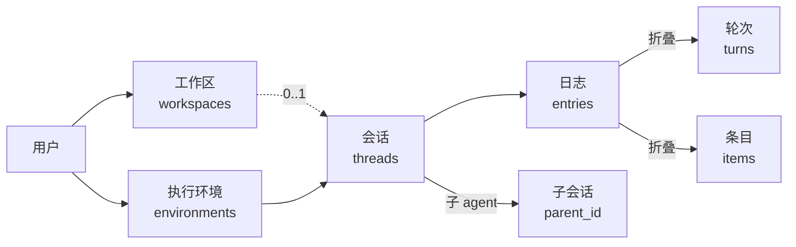
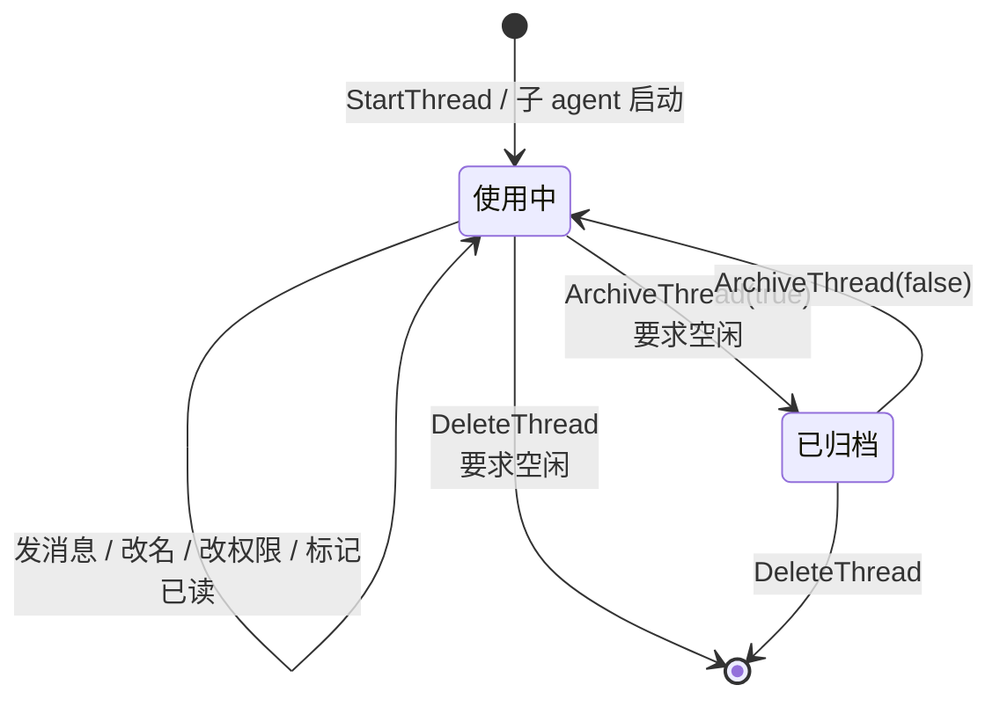
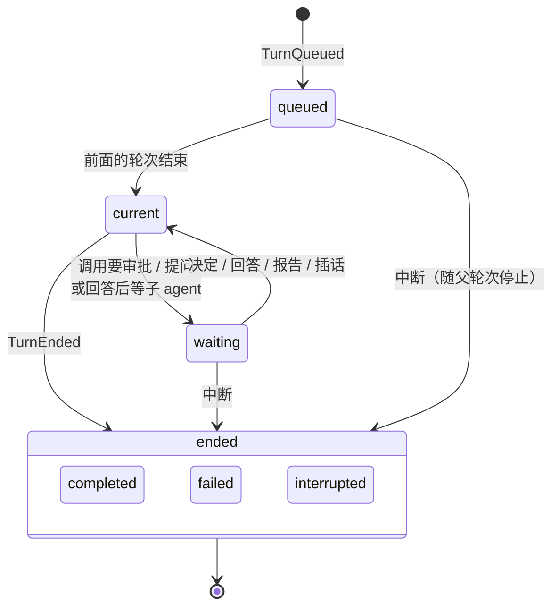
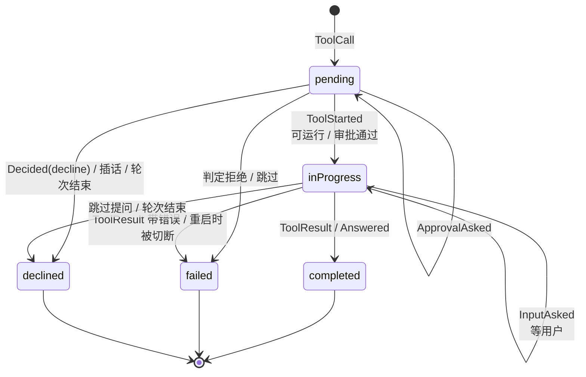

# 工作区、会话、轮次、条目

引擎里用户看得见的状态由四个概念组成：工作区（workspace）装着会话（thread），会话由一个个轮次（turn）组成，轮次里的每一步都是条目（item）。会话的轮次和条目不单独保存，它们是会话**日志**的投影：日志只追加、不修改，状态都从日志算出来。这一页讲每个概念是什么、怎样诞生、经过哪些状态、怎样结束，以及它们之间的约束。

本页按当前代码写，面向贡献者。对外的完整文档在 [ollupi-docs](https://github.com/0xfakeSpike/ollupi-docs) 的 `docs/engine/`，那里描述的是 `engine.json` 记的引擎版本。

| 概念 | 是什么 | 保存在 | 归属 | 怎样结束 |
|---|---|---|---|---|
| 工作区 | 用户沙箱里的一个项目文件夹，带一层权限设置 | `workspaces` | 用户 | 只能归档，不能删除 |
| 会话 | 一段对话，运行在某个环境、某个工作区里 | `threads`，日志在 `entries` | 用户；子会话还属于父会话的一个调用 | 归档或删除，二者都要求空闲 |
| 轮次 | 用户（或定时任务、父 agent）交给 agent 的一件事 | 日志的投影，物化在 `turns` | 会话 | `completed` / `failed` / `interrupted` |
| 条目 | 轮次里的一步：一条消息、一段思考、一次工具调用…… | 日志的投影，物化在 `items` | 会话和轮次 | `completed` / `failed` / `declined` |

## 一条路写，一条路读，一条路通知

- **写**：一切变化都是向日志追加记录（`conversation.Entry`），在 `store.Update` 的一个事务里完成。`Tx.Append` 先用 `conversation.Check` 判断每条记录能不能接在当前日志后面，不能就整个事务失败（`conversation.ErrRefused`）；能就用 `conversation.View.Apply` 折叠进视图，再把变了的轮次、条目和会话的状态列一起写下。
- **读**：视图（`conversation.View`）由同一组纯函数从日志折叠出来；`turns`、`items` 表和 `threads` 的 `head`、`own_status`、`runnable_since` 列只是它的物化，为了查询。`status` 是会话的状态加上子会话对用户的等待：子会话在等审批或回答时，父会话也显示在等，审批排在回答前面（`conversation.RollUp`）；子会话的记录写入时，store 在同一事务里重算祖先会话的这一列。
- **通知**：事务提交之后，它改变的东西作为一个事件发到 store 的 feed 上（`store.Event`），同一次提交的事件共用一个序号 `seq`。gateway、调度器、记忆抽取都只从 feed 得知变化；写的一方不通知任何人。

代码：[conversation/](../conversation/)、[store/store.go](../store/store.go)、[store/sqlite/](../store/sqlite/)。

## 工作区

工作区是用户沙箱（`sandbox.Box`）里的一个文件夹。会话的工具调用在这个文件夹里运行，工作区的权限设置是权限分层里的一层（部署 → 用户 → 工作区 → 会话）。会话也可以不挂工作区。

- **添加**：`app.AddWorkspace` 先让沙箱确认路径是个目录（`box.Directory`），再按文件夹去重：同一用户已有指向同一文件夹的工作区（`box.Same`）就用它，已归档的顺带恢复。
- **移动**：`app.MoveWorkspace` 把文件夹搬到一个已存在且为空的目录，只改 `root`。会话、记忆、定时任务都按工作区 id 引用它。移动要求名下的会话都空闲（`Reader.WorkspaceBusy`），移动期间 app 拦住新轮次。
- **归档**：已归档的工作区不能新建会话，名下的会话也不能发新消息（`user.ErrWorkspaceArchived`）。

代码：[user/user.go](../user/user.go)、[app/owned.go](../app/owned.go)。

## 会话

会话是一段对话。它运行在一个执行环境里（不指定时是这台机器），可选地挂在一个工作区上，带一层自己的权限设置。

- **顶层会话**：用户通过 `app.StartThread` 创建，出现在会话列表里。
- **子会话**：子 agent 的会话。父会话里启动它的调用结束时，runner 在同一事务里创建子会话、给它排上第一个轮次和任务消息（`run.launch`）。它记着 `parent_id` 和 `parent_item`，继承父会话的工作区和环境，按父会话的权限运行；它不接受用户的消息（`user.ErrSubagentThread`），随父会话一起删除。

- **当前轮次**：日志里第一个还没结束的轮次（`View.Active`）。其余没结束的排在它后面（`View.Behind`）。同一会话任何时刻只运行当前轮次。
- **会话状态**从视图算出（`View.Status`）：没有当前轮次是 `idle`；当前轮次在等审批或回答是 `waitingOnApproval` / `waitingOnUserInput`；否则是 `active`。
- **可运行**：有当前轮次且它不在等任何东西（`View.Runnable`）。store 记下它变成可运行的时刻，调度器按这个时刻先后取会话。
- **未读**：顶层会话的轮次结束时写 `replied_at`；标记已读时写 `read_at`。
- **归档、删除**：要求会话空闲。已归档的会话不能发新消息（`app.ErrThreadArchived`）。删除连同日志、子会话、定时任务和附件一起删掉。

代码：[app/threads.go](../app/threads.go)、[store/sqlite/conversations.go](../store/sqlite/conversations.go)。

## 轮次

轮次是交给 agent 的一件事。它有三个来源，都是追加 `TurnQueued` 和一条 `UserMessage`：

| 来源 | 写入 |
|---|---|
| 用户发消息 | `app.Send`，每条消息一个轮次 |
| 定时任务到点 | `cron.Run` 调 `app.Scheduled`，`TurnQueued.CronJob` 记着任务 |
| 子 agent 被启动 | `run.launch`，和父会话里结束启动调用的记录在同一个事务里 |

会话空闲时，新轮次就是当前轮次；会话忙时它排在后面，等前面的轮次结束。排队上限是 20 个轮次（`maxQueued`）。用户想把话说给正在运行的轮次，用 `app.Steer`：消息追加进当前轮次，agent 在下一步读到它。

### 状态

轮次没有状态列。它要么已结束（`TurnEnded` 记着 `completed` / `failed` / `interrupted` 和原因），要么没结束；没结束的轮次是当前轮次，或排在后面。当前轮次在做什么，看它的条目：

| 看到的 | 意思 | 调度器 |
|---|---|---|
| 不在等任何东西 | 可运行 | 有空槽位就运行它 |
| 有调用在等审批 / 等回答 | 等用户 | 不运行；用户决定或回答后又可运行 |
| 已经回答，它启动的子 agent 还没全部汇报 | 等子 agent | 不运行；每个报告到达时又可运行 |

谁让轮次前进：

- **调度**：`schedule.Scheduler` 订阅 feed。有会话变得可运行，它从 `Reader.Runnable` 取出等得最久的（用户自己的会话排在子会话前面），在总槽位和每用户槽位以内交给 runner。槽位只在内存里，重启后从 store 重新取。
- **运行**：`run.Runner.Run` 每一步重新读日志，问 `agent.Next` 下一步做什么，做完把结果追加回日志，直到轮次要等或结束：
  - `CallModel`：先在需要时追加记忆（`Recalled`）或压缩（`Compacted`），再请求模型；流式文字作为增量发到 feed（不落库），回复、它的消息和它的每个调用在一次提交里写下。每个调用写下时已经过权限判定：直接可运行、要问用户（`ApprovalAsked`），或被拒绝（`ToolResult` 带错误）。
  - `RunTools`：只读的调用一起执行，其余一次一个；先追加 `ToolStarted`，执行完追加结果。工具的结果也可以是一个问题（`InputAsked`）或要启动的子 agent。
  - `SkipTools`：用户拒绝了某个调用、或预算用完后，剩下的调用不执行，记为跳过。
  - `Finish`：轮次已经回答，追加 `TurnEnded{completed}`；子会话的轮次还在同一事务里把回答作为报告写进父轮次（`ChildReported`）。
  - `Wait`：让出槽位。
- **结束**：`run.End` 结束一个轮次：先关掉它还没结束的调用（等回答的记为跳过，其余记为被拒绝），再停掉它启动的、还没汇报的子 agent，最后追加 `TurnEnded`。子会话的轮次结束时向父轮次汇报。
- **中断**：`app.Interrupt` 就是 `run.End(interrupted)`。调度器在 feed 上看到正在运行的会话的轮次结束了，取消对应的运行。
- **失败**：运行出错或超过时限（默认四小时），调度器在让出槽位之前用 `run.End(failed)` 结束轮次。
- **重启恢复**：没有单独的恢复流程。runner 接手一个会话时，先把上一次运行留下的、已开始未结束的调用（`ToolStarted` 之后没有结果）记为被切断：它可能已经生效，agent 被提示先核实再重试，绝不会自动执行两次。

定时任务的轮次和用户的轮次一样排队。上一次运行还排在别的轮次后面时，这一次跳过且不计数（`cron.send`）。

代码：[agent/agent.go](../agent/agent.go)、[run/](../run/)、[schedule/schedule.go](../schedule/schedule.go)、[app/turns.go](../app/turns.go)、[cron/cron.go](../cron/cron.go)。

## 条目

条目是轮次里的一步，由一条或几条日志记录折叠而成：一次工具调用从 `ToolCall` 开始，依次可能有 `ApprovalAsked`、`Decided`、`ToolStarted`、`InputAsked`、`Answered`、`ChildLaunched`，到 `ToolResult` 结束。

### 类型

| 类型 | 由哪条记录开始 | 含义 |
|---|---|---|
| `userMessage` | `UserMessage` | 用户消息：开启轮次的消息、插话、子 agent 的任务 |
| `agentMessage` | `AgentMessage` | 模型回答的正文 |
| `reasoning` | `Reasoning` | 模型的思考内容 |
| `toolCall` | `ToolCall` | 一次工具调用，参数、计划、审批、提问、结果都折叠在这一个条目里 |
| `contextCompaction` | `Compacted` | 一次上下文压缩，`text` 是摘要 |
| `memoryContext` | `Recalled` | 这一轮召回的记忆 |
| `notice` | `Notice` | 运行时告诉模型的话，比如工具为什么停了 |
| `error` | `ModelFailed` | 模型调用失败 |
| `agentReport` | `ChildReported` | 一个子 agent 的报告，送回启动它的轮次 |

### 状态

| 状态 | 含义 |
|---|---|
| `pending` | 调用已记下、未执行，或在等审批 |
| `inProgress` | 调用已开始执行，或在等用户回答 |
| `completed` | 成功 |
| `failed` | 失败，`error` 写原因 |
| `declined` | 用户拒绝了这次调用、跳过了提问，或轮次结束时它还没执行 |

消息、思考、报告等写下时就已结束。工具调用：

### 写入约束

`conversation.Check` 是唯一的守门人：

- 已结束的轮次不能再追加任何记录；还有调用没结束时不能追加 `TurnEnded`。
- 排在后面的轮次只能追加用户消息和 `TurnEnded`；其余记录只能写给当前轮次。
- 新条目要用新的 id；调用的每一步都要接在它当前的状态之后（比如只有在等审批的调用才能 `Decided`，只有在等回答的调用才能 `Answered`）。
- 记录写下后不再修改；审批依据的参数和计划（`Prepared`）就是 `ToolCall` 记下的那份，不会被悄悄换掉。

代码：[conversation/check.go](../conversation/check.go)、[conversation/view.go](../conversation/view.go)。

## 四者之间的约束

| 操作 | 要求 | 对下层的影响 |
|---|---|---|
| 归档工作区 | 无 | 不能新建会话，名下会话不能发新消息 |
| 移动工作区 | 名下会话都空闲 | 只改 `root`，其余都按 id 引用 |
| 归档会话 | 空闲 | 不能发新消息 |
| 删除会话 | 空闲 | 日志、子会话、定时任务、附件一起删除 |
| 结束轮次 | 有当前轮次 | 还没结束的调用先关掉；它启动的子 agent 被停掉并汇报；子会话的轮次向父轮次汇报；排在后面的轮次成为当前轮次 |
| 追加记录 | 通过 `conversation.Check` | 可能让会话变得可运行，调度器从 feed 得知 |
